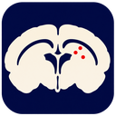

# FosFolio 脑片图册

多通道脑片配准与细胞定量。v0.8.6 起使用新名称，原 FosMap 用户可从软件内检查更新。

原名“cFos 脑片分析”。版本号规则：x.y.1 到 x.y.10 是小版本（补丁，软件内自动更新）；x.y.10 之后的下一个版本是大版本 x.(y+1).0，并发布正式 GitHub Release。例如 0.8.10 之后是 0.9.0。

**使用说明书（研一新生版）**：[在线阅读](docs/使用说明书/使用说明书.md) · [Word](docs/使用说明书/cFos脑片分析_使用说明书_v0.7.docx) · [PDF](docs/使用说明书/cFos脑片分析_使用说明书_v0.7.pdf)

面向小鼠脑切片荧光图像的一体化分析软件：脑片拆分 → 亮度/对比度 → 逐通道细胞识别 → 共标统计 → CCFv3 配准 → 分组统计 / 功能网络 → 导出 Excel。

## v0.9.1 Olympus VSI 多扫描区

添加一次 `.vsi` 即可逐区导入荧光扫描。每个扫描区在“当前图片”中显示原始名称，可独立拆分脑片、识别细胞和导出统计。旧项目重新添加同一文件，即可保留原有最大扫描区的结果并补入其他区域。

## v0.9.0 安装与升级

下载 [Windows x64 安装程序](https://github.com/zjm199502/cfos-brain-slice/releases/download/v0.9.0/FosFolio-0.9.0-Windows-x64-Setup.exe) 或 [Apple 芯片 Mac 安装包](https://github.com/zjm199502/cfos-brain-slice/releases/download/v0.9.0/FosFolio-0.9.0-macOS-arm64.zip)。旧版用户可在「帮助 → 检查更新」打开新版下载页。本版使用完整安装包升级。

细胞识别支持选择单张或多张脑片。单层厚切片可以先用人工标注视野比较漏检和误检，再将选定的参数应用到相应脑片。Excel 默认合并左右半脑，导出时可以选择分侧统计。详见[本版更新公告](packaging/更新公告/0.9.0.md)。

### 首次使用 Cellpose 4

**完整离线包**包含 Cellpose 4.2.1、平台对应的 PyTorch、全部 Python 依赖和 Cellpose-SAM v2 权重。Windows 用户把离线压缩包完整解压，保留安装程序与所有分卷在同一目录，运行 Setup.exe。Apple 芯片 Mac 用户解压后，先把应用拖入“应用程序”，打开并同意首次离线配置。两端都可以在「④ 细胞识别」从随包文件修复环境和测试设备。安装程序会校验文件，在真实模型推理通过后启用环境。以下首次下载步骤适用于常规安装包。

所有启用的通道使用 Cellpose-SAM v2（`cpsam_v2`）独立生成轮廓。各通道可以分别调整 Cellpose 掩膜阈值，默认值为 0。DAPI、EGFP 和 Fos 的阳性筛选仍使用各通道的面积、亮度和局部背景设置。

在「④ 细胞识别 → 安装 / 修复 Cellpose 4 运行环境」完成首次下载，再点「测试 Cellpose 设备」查看实际推理设备。Windows 上兼容的 NVIDIA 显卡使用 CUDA，Apple 芯片 Mac 使用 PyTorch MPS（Metal），也可选择「仅 CPU」。首次安装需要联网并预留数 GB 空间，模型保存在本机，以后可离线识别。已有运行环境可通过 `CFOS_CELLPOSE_PYTHON` 指向 Python 解释器，通过 `CFOS_CELLPOSE_WEIGHTS` 指向官方 `cpsam_v2` 权重文件。

打开已有项目可继续查阅原始计数。再次识别使用 Cellpose 4，已有 StarDist 自训练权重及概率阈值仅适用于原模型。正式统计前可在人工评估视野复核新模型的漏检和误检。

## v0.8.4（小更新）：直接读取奥林巴斯 .vsi
- **.vsi 读取**（`core/vsi.py` + `core/vsi_meta/`）：纯 Python，不需要 Java / Bio-Formats。像素在同名“_名字_”文件夹的 `stackN/frame_t*.ets` 里，`vsi.read_ets_index` 读图块表，图块支持不压缩 / JPEG / JPEG 2000（imagecodecs）；金字塔、拼接扫描的原点偏移、缺失图块（按 0）都处理。`VsiFile` 与 `KfbfFile` 接口相同，接在 `Slide._kf` 上。
- **元数据**：`core/vsi_meta` 取自 bioio-vsi（BSD-3），解析通道名、发射波长、像素尺寸、维度顺序（Z / T / 通道的顺序每个文件都可能不同）。通道名看不出染料时把发射波长写进名字，`guess_role` 就能认出来。文件里有多幅图（标签、预览图、主扫描图）时用最大的主扫描图；说明信息读不懂时只靠 .ets 读图并提示。
- **z-stack**：按项目的合成方式（最大投影 / 景深合成 / 平均 / 指定层）读取时合成；8 位和 16 位都支持。明场 RGB 扫描会提示不支持。
- 测试：`tests/v084_vsi.py`（真实样本 `tests/data/vsi`，来自 zenodo 6094961，CC BY 4.0；加合成 .ets）。

## v0.8.3（小更新）：DAPI 比例主指标、自定义显示颜色、强度去串色、多线程读图
- **X+ 占 DAPI+ 的比例**（`core/coloc.add_nucleus_ratios`）：导出三张计数表都加“X+ 占 DAPI+ 的比例 %”（分子 = DAPI+X 共标，分母 = DAPI+）和“比例提示”列（DAPI+ < 200，或 `regions.DENSE_REGIONS` / 小脑皮层）；`stats.metric_options` 把它放在首位，`stats.add_metrics` 按动物合计计数后再算；组间比较表也带提示列。
- **显示颜色**：`DisplayChannel.color`（项目文件 `display`），`Project.custom_color()`；看图（napari 自定义色表）、质控图、截图制图、配准图都用它。新项目默认沿用文件里存的颜色（`ChannelInfo.file_color`，qptiff 页描述 / OME Channel Color）。
- **通道判断**：`slide_io.guess_role` 先看染料词，再看三位数波长，最后才看文件颜色（只认纯蓝/绿/红/品红）。
- **脑区平均荧光强度去串色**：`regions.region_intensity_sums(..., unmix_model)` 每块逐像素解混后累加；缓存签名包含解混矩阵（未开启时签名不变）。自定义区域同样处理。
- **多线程读图**（`core/tileread.py`）：图块存储的单层 TIFF 由 `TiledTiffLevel` 直接按图块解码（`TiffPage.decode`），.kfbf 同样并行；线程数 = min(4, `cpu.main_threads()`)，`CFOS_DECODE_THREADS` 可改，`CFOS_FAST_READ=0` 退回 zarr。每张图片 128 MB 已解码图块 LRU 缓存。结果与原读法逐像素一致。
- 测试：`tests/v083_core.py`、`tests/v083_gui.py`、`tests/upgrade_direct.sh`（v0.7 手动 / v0.8 / v0.8+0.8.1 / v0.8+0.8.2 → 最新）。

## v0.8.1（小更新）：改名 FosMap、配准质控、行为相关、不再依赖 TensorFlow
- **改名**“FosMap 脑片活动图谱”，新图标（`cfos/gui/assets/`，源文件 `fosmap_logo.svg`）。`cfos.APP_NAME` 是显示名称；安装目录（`%LOCALAPPDATA%\cFos脑片分析`）、用户数据目录（`cfos脑片分析`）和项目格式都不变，旧版本的自动更新照常识别。
- **配准质控**（`core/quality.py`）：标记物通道阳性细胞落在白质（fiber tracts）或脑室的比例 > 5% 提示“注意”，≥ 10% 提示“可疑”。示例脑片 1.4%；人为把 AP 位置错开 2.5 mm 时轮廓重合度仍有 0.87（不报警），但这一项升到 16%，能标出来。
- **脑区活动与行为相关**（`core/behavior.py`）：每只动物一个行为分数（项目文件 `behavior`），逐脑区 Spearman 相关 + Bonett–Wright 95% CI + BH-FDR，输出 xlsx、相关系数图、散点图。测试 `tests/behavior_smoke.py`。
- **细胞轮廓紧凑存储**（`core/contours.py`）：轮廓存成一个 float32 数组 + 偏移量，结果文件改名 `*_cells.v2.pkl`、`parts/*/<脑片>.v2.pkl`（旧版本软件看到的是“未识别”，不会出错）；旧格式照常读取，保存时转换。共标判断每个轮廓只建一次 Path。
- **质量检查分块读图**：逐通道、按行分块（上下重叠 16 行，覆盖高通滤波和景深合成的邻域），结果与整张读入逐位相同（示例脑片和合成 z-stack 都核对过）。
- **不再依赖 TensorFlow**：细胞识别直接读 `model.onnx`（`core/sdnet.py`，与 StarDist2D.predict_sparse / predict_instances 逐行对应，结果完全相同）；DeepSlice 两个模型转换为 ONNX（`core/deepslice_onnx.py`，打包时由 `packaging/make_onnx.py` 生成；预处理与 Keras 逐位相同，切面参数最大差 0.0001 体素）。核对脚本 `tests/v081_onnx_check.py`。
- **微调组件按需下载**（`core/components.py`）：TensorFlow、tf2onnx 等只有训练才需要，做成组件包（`packaging/make_components.py`，版本锁定为开发环境的版本，90 MB 分卷 + MD5，清单 `updates/components.json`）；第一次训练时自动下载（断点续传、校验、解压到用户目录、子进程自检），离线包用“帮助 → 安装微调组件（离线包）”。训练完立即转换 ONNX，以后识别不需要 TensorFlow。打包脚本已把这些组件从安装包里去掉。测试 `tests/components_e2e.py`（用 `tests/no_tf` 模拟没有 TensorFlow 的环境）。
- 界面测试：`tests/v081_smoke.py`。

## v0.8：补丁更新、厚切片去卷积、脑区平均荧光强度
- **补丁更新**：以后的更新只需下载约 0.2 MB 的补丁包（只含程序代码），不用重新下载完整安装包。
  - 软件启动后在后台检查 `installers` 分支的 `updates/latest.json`（先 GitHub，连不上用 jsDelivr 镜像），有新版本时弹窗显示更新公告，点“现在更新”下载、核对 SHA-256、安装，重启后生效。
  - 补丁装在用户目录的“更新”文件夹里（Windows：`%LOCALAPPDATA%\cfos脑片分析\更新`；Mac：`~/Library/Application Support/cfos脑片分析/更新`），不改动安装目录；`main.py` 启动时把补丁代码放在最前面（后台计算进程也一样）。
  - 补丁连续两次没能正常打开主窗口会自动停用；“帮助 → 恢复到安装时的版本”可手动停用。
  - 也可以在 GitHub 的 `installers/updates/` 手动下载补丁 zip，用“帮助 → 从文件安装补丁…”安装。v0.7 等旧版本没有更新功能，可以用补丁 zip 里的“手动安装”脚本升级一次。
  - 补丁写明需要的完整安装包最低版本（`min_base`）；Python 组件、模型、图谱变了时必须提高它，用户会被提示下载完整安装包。
  - 发布：`python packaging/make_patch.py <输出文件夹> --min-base 0.7`（更新公告写在 `packaging/更新公告/<版本>.md`，结尾自动加联系方式），把输出放到 `installers` 分支的 `updates/`。
- **厚切片**推荐参数默认勾选“识别前去卷积”，并弹窗说明（识别用去卷积后的图，亮度测量用原图）。
- **脑区平均荧光强度**：Excel“按脑区×脑片”新增每个通道的平均荧光强度（原图分辨率的原始灰度值，不含排除区域和组织外）和“相对整张脑片”的比值；“按自定义区域”也有平均荧光强度。没有阳性细胞的脑区也会列出。
- “帮助”菜单：关于（功能介绍、联系方式）、检查更新、从文件安装补丁、恢复到安装时的版本、自动检查开关。
- 安装包再小约 84 MB：DeepSlice 的 92 MB Xception 预训练文件只用到最顶上的分类层，改为只带这一层（`resources/deepslice/xception_top.npz`，8 MB），定位结果完全相同。
- 第三方组件与致谢：见 [THIRD_PARTY.md](THIRD_PARTY.md)（`packaging/list_third_party.py` 自动生成）。
- 测试：`tests/v08_smoke.py`；补丁更新的端到端测试见 `tests/update_e2e.sh`。

## v0.7：更准、更稳、更小更快，配准图导出
- **细胞识别改用 ONNX Runtime**（CPU）：示例脑片 4 核 446 s → 230 s，每个细胞位置差 < 0.05 像素，计数完全相同。需要时可设环境变量 `CFOS_NET=tf` 改回 TensorFlow。
- **配准加入 DAPI 纹理**：非线性配准同时对齐外轮廓和 DAPI 图像与 Allen 参考图的纹理（互信息），内部结构（纤维束、脑室）更准；变形异常（雅可比 ≤ 0.05）或外轮廓变差时自动退回只用轮廓。
- **识别准确率检查**（④ 细胞识别）：放一个方框，人工点出框内细胞，软件自动配对（≤ 6 µm），给出查准率、查全率、F1，标出漏检和误检；记录保存在项目里并写入 Excel“分析参数”。
- **平滑的脑区边界显示**（⑥ 配准按 3 倍平滑放大显示）。
- **整张脑片配准图导出**（⑥ 或 ⑨）：整张脑片 + 脑区轮廓 + 缩写（自动避开重叠）+ 中线 + 比例尺；轮廓颜色白/黑/黄/图谱颜色，可只画轮廓（白底黑线）；SVG 中每个脑区是独立的矢量路径，可在 Illustrator / Inkscape 编辑。输出在“截图/配准图”。
- **诊断包**（① 页面）：出问题时一键打包电脑/软件信息、日志、项目设置（不含图片），发给开发者。
- **安装包瘦身**：不打包用不到的组件（见 `packaging/不打包的组件.txt`），并删除 DeepSlice 不用的权重等，约小 200 MB。
- **安装后自检**（① 页面“软件自检”，或 `main.py --selftest`）：用示例脑片走一遍读图、识别、配准、导出，结果写到日志文件夹的“自检结果.txt”，诊断包里也带上。
- 通用识别模型在打包时就转换成 ONNX（`packaging/make_onnx.py`），用户电脑上不用转换；需要转换时（微调模型）安装目录写不进去就存到用户目录。
- Excel“分析参数”新增：软件版本、识别神经网络、各通道识别模型、每张脑片的配准方法、手动修正点数。
- 测试：`tests/v07_smoke.py`。

## v0.6：⑨ 截图制图、拖动边界修正
- 新增第 9 步“截图制图”：在图上画截图框（ROI，可多个、可固定 µm 大小、可按脑片相对位置复制到其他图片），选通道、叠加细胞轮廓 / 脑区边界 / 脑区缩写 / 排除区域 / 定位小图，加可编辑的比例尺（长度、粗细、颜色、位置、字号、是否标注），导出 PNG（300 dpi）/ TIFF（无损，带分辨率）/ SVG（比例尺为矢量，可在 Illustrator 中编辑），每张图附带参数 JSON（位置、µm/像素、框内各通道细胞数）。
- 截图框和设置保存在项目里；输出在项目文件夹的“截图”子文件夹。
- “⑥ 脑图谱配准”新增**拖动边界手动矫正**：点“拖动边界修正”，在图上按住黄色脑区边界线拖到正确位置后松开，附近边界弹性跟随，“影响范围”（200–4000 µm，滑块）以外的部分完全不动；可多次拖动、撤销上一个、清除全部。修正点保存在项目里（带影响范围），脑区统计、Excel、质控图、截图制图都按矫正后的边界计算。
- 图片格式方面：Olympus VS120 的 .vsi/.ets 暂不支持（先搁置）。

## v0.5.1：修复多核 Windows 电脑上识别极慢的问题
- TensorFlow 的 oneDNN 优化在某些多核 Windows 电脑上会让识别慢几百倍（32 核电脑实测：一块图 5 分钟算不完，关掉后 1.1 秒）。现在启动时自动关闭。
- 最多只用一半的 CPU 核（例如 32 核用 16 核：神经网络 10 线程 + 细胞测量 6 个进程），不影响同时做别的事；进程优先级设为“高于正常”。状态栏会显示 CPU 使用情况。

## 第 5 版（v0.5）：更快，并支持 Mac
- 细胞识别改为多核并行（去重、描轮廓、测量交给多个后台进程），示例脑片全流程在 4 核电脑上从约 7.4 分钟降到 3.8 分钟；结果与单进程逐项相同。
- 提供 Windows 安装包和 Mac（Apple M 系列芯片，macOS 15 以上）版本，见 Releases。
- 修复：视野在图片外时“预览减背景”报错；模型微调后刷新识别面板报错。

## 第 4 版（v0.4）：实验分析、质量控制、教学
- **⑦ 分组与统计**：填写动物编号和组别（可导出/导入 Excel）；按动物汇总后组间比较（Welch t / Mann-Whitney U，FDR 校正）；火山图、柱状图、脑区热图（画回 CCF 冠状切面）。同一动物填进两个组会报错，编号只差大小写/全角会提醒。
- **脑区功能网络分析**（在 ⑦ 中）：每组跨动物的脑区相关矩阵；多阈值建网；度、介数、枢纽脑区、Louvain 模块；组间 Fisher z（每条边）+ 置换检验（全局指标和每个脑区的度）+ FDR；bootstrap 置信区间、留一法枢纽稳定性；小样本提示。输出 网络分析.xlsx、网络图、相关矩阵、阈值曲线。
- **连续切片联合校正**（⑥）：同一动物的切片统一切面角度，可选等间距；可撤销。
- **人工修正细胞**（④）：补画漏掉的、删除误识别的；改阈值、重新识别后仍有效；Excel 记录人工改动比例。
- **用自己的标注微调识别模型**（④，CPU）：训练前后在留出的标注块上比较 F1。
- **强度分级**（⑤）：弱 / 中 / 强阳性（倍背景），全项目统一分界，可作为统计指标。
- **自动质量检查**（②、批量处理、导出）：配准重合度、模糊、过曝、组织缺损、DAPI 密度异常；正常 / 注意 / 可疑，Excel 中标黄/标红。
- **换电脑后找回原图**（①）：项目和原图一起搬走时自动找回；否则选文件夹按文件名（和文件大小）搜索。
- **教学模式**（顶部勾选）：每步要点、正误参考图、常见错误；左侧步骤完成打勾；“打开示例项目”用一张示例脑片练习全流程（含参考答案）。
- 开发工具：`tools/make_demo.py` 生成示例图，`tools/make_teaching_images.py` 生成参考图和参考答案。

## 第 3 版（v0.3）：厚切片支持、易用性、稳定性、灵活性

**厚切片（~40 µm）**
- 支持 z-stack 图片（OME-TIFF 等含 Z 轴的多通道文件），读取时自动合成为一层：最大投影（默认）、景深合成（每处取最清晰的层）或平均投影；单层扫描和扫描仪已做 EDF 的图片照常使用。
- 新的“局部对比度”筛选：细胞内亮度 ÷ 细胞外 3 µm 环（不含其他细胞）的亮度。焦平面外的细胞是一团光晕，对比度低，可以去掉。
- “④ 细胞识别”中一键选择“厚切片推荐参数”：识别前减背景 25 µm、局部对比度 ≥ 1.5、共标距离 8 µm。

**稳定性**
- 每张脑片识别完马上保存；取消、死机或断电后再点一次识别，会跳过已经做完的脑片。
- 批量处理时某张图片出错（文件损坏、通道数不同、找不到脑片等），会记录原因并继续处理其他图片，结束时列出。
- 错误信息改为中文说明；详细记录写入运行日志（用户目录和项目文件夹各一份）。
- 项目文件保存时自动备份，主文件损坏时自动用备份打开。

**灵活性**
- 改面积、最低强度、自动阳性阈值、局部对比度后，点“按新阈值重新筛选”几秒钟就能更新，不需要重新识别。
- 排除区域：在图上圈出折叠、气泡、破损处，区域内的细胞和脑区面积都不计入。
- 自定义分析区域：不依赖图谱，自己圈区域统计（Excel 多一张“按自定义区域”表，只在画了区域时出现）。
- 导出时可选择不列出皮层各层、或只列到第 N 级脑区。
- 脑区面积只统计组织轮廓以内的部分（以前包含了轮廓外的图谱区域），密度更准确。

**易用性**
- 参数模板：把所有参数存成一个文件，给同学或下一个项目导入，保证分析标准一致。
- 导出时为每张脑片生成质控图（PNG），叠加识别到的细胞、脑区边界和排除区域，批量处理后可以快速翻看。

## 第 2 阶段（CCFv3 配准和按脑区导出）

- DeepSlice 自动估计每张切片在 Allen CCFv3 中的位置和角度，自动识别倒放的切片（试 0°/180°，选与图谱轮廓重合最好的方向）。
- elastix 非线性贴合组织轮廓；界面上可用滑块调整前后位置、倾斜、缩放、旋转、平移，也可以拖动修正点做局部修正。
- 导出 Excel 增加“按脑区汇总”“按脑区×脑片”：分左右半脑，包含所有上级脑区、脑区面积和细胞密度。
- DAPI 识别前伽马提亮；共标支持“核内 DAPI 信号足够强也算有核”和“只统计有核细胞”；每个通道可设“自动阳性阈值（几倍背景）”。

## 第 1 阶段（读图和细胞计数）

- 支持 qptiff（KFBIO / Vectra 格式）、OME-TIFF、多通道 TIFF；自动读取通道名和像素尺寸。
- 自动拆分一张玻片上的多张脑片，可在图上拖动方框手动修正、取消不需要的脑片。
- 每个通道独立用 StarDist（CPU 即可）识别阳性细胞，可先“预览当前视野”调参数。
- 共标：不同通道中位置重合的细胞（中心距离 ≤ 6 µm，或中心落在另一细胞轮廓内）按一对一匹配合并。
- 导出 Excel：按脑片汇总、按图片汇总、细胞明细、分析参数。
- 所有设置和结果保存在项目文件夹，可以关闭后继续。

## 安装

从 [GitHub Releases](https://github.com/zjm199502/cfos-brain-slice/releases/latest) 下载适合本机的完整安装包。

- **Windows x64** 用户双击 Setup.exe，按安装向导操作。
- **Apple 芯片 Mac（macOS 15 及以上）** 用户解压 macOS-arm64.zip，将应用拖入“应用程序”文件夹。升级前先退出正在运行的旧版本。

## 资源文件

图谱（`resources/atlas`）、DeepSlice 权重（`resources/deepslice`）和示例脑片（`resources/demo`）体积较大，不放在仓库里，已经包含在安装包中。从源码运行时，请从安装包里把 `app/resources` 下这三个文件夹拷到本仓库的 `resources/` 下。

## 打包

- Windows：`bash packaging/build_windows.sh <工作目录>`（在 Linux 上交叉打包，需要 makensis）
- Mac：`bash packaging/build_mac.sh <工作目录>`

## 目录

- `main.py`：程序入口
- `cfos/core/`：图像读取、脑片拆分、细胞识别、共标、导出（不依赖界面，可单独测试）
- `cfos/gui/`：界面
- `cfos/core/cellpose_setup.py`：按需安装独立 Cellpose 4 运行环境，下载和校验 Cellpose-SAM v2 权重
- `resources/atlas/`：Allen CCFv3 25 µm 图谱（来自 BrainGlobe allen_mouse_25um v3.1）
- `resources/deepslice/`：DeepSlice 小鼠模型权重和 Xception 预训练权重
- `tests/gui_smoke.py`：无人值守地走一遍界面流程并截图
- `tests/figure_smoke.py`：⑨ 截图制图 的界面测试（通过 `tests/run.py` 运行）
- `tests/boundary_smoke.py`：⑥ 拖动边界手动矫正 的界面测试

## 联系方式：zjm199502@163.com 

## 第三方组件与致谢：[THIRD_PARTY.md](THIRD_PARTY.md)
