% cFos 脑片分析 软件使用说明书
% 适用版本 v0.7 · 面向研一新生 · 2026 年 11 月

# 写在前面

## 这本说明书怎么读

这本说明书写给刚进实验室、没有写过代码的同学。你不需要懂编程，也不需要会用 QuPath、ImageJ 或 ABBA，软件里的每一步都是点按钮、拖滑块完成的。

建议这样读：

1. 先读第 1 章“安装软件”，把软件装好，做一次“软件自检”。
2. 读第 2 章“认识界面”，花 5 分钟熟悉窗口里各部分是做什么的。
3. 跟着第 3 章，用软件自带的示例脑片完整走一遍（约 20 分钟）。做完一遍，你就知道整个流程了。
4. 分析自己的数据时，按第 4–12 章逐步操作，遇到不懂的参数再回来查。
5. 出问题时看第 16 章“常见问题”和第 17 章“出错了怎么办”。

说明书里的格式约定：

- **加粗的文字**是需要特别注意的地方。
- 「按钮名」或“按钮名”指软件界面上的按钮、选项，文字和软件里完全一样，可以照着找。
- “① 项目与图片”这样带圆圈数字的，是软件左侧的步骤名称。
- 截图大多来自 v0.7 和软件自带的示例脑片；少数截图（手动校正、模型微调、质量检查等）来自早期版本，左侧步骤数或数字可能略有不同，但按钮名称和操作方法相同。

> 提示：软件里有“教学模式”（窗口右上角的勾选框），打开后每一步顶部都会显示“本步要点”、正确和错误的参考图、常见错误。第一次用时建议一直开着。

## 这个软件能做什么

这个软件用来批量分析小鼠脑切片的荧光染色图像（例如 c-Fos 免疫荧光），把“图片”变成“每个脑区有多少阳性细胞”的 Excel 表格。主要功能如下：

| 功能 | 说明 |
|---|---|
| 读取全片扫描图 | 支持 .qptiff（KFBIO / Vectra 等扫描仪）、OME-TIFF、多通道 TIFF；支持单层扫描、扫描仪做过景深合成（EDF）的图，以及 z-stack 多层扫描 |
| 自动拆分脑片 | 一张玻片上的多张脑片自动分开，可以手动调整 |
| 亮度 / 对比度调整 | 只影响显示和导出的图片，不影响计数 |
| 去卷积、减背景 | 识别前让细胞边界更清楚、去掉雾状背景 |
| 细胞识别 | DAPI、Green、Red、Far red 每个通道单独识别阳性细胞（StarDist 深度学习模型，不需要显卡） |
| 共标统计 | 不同通道中位置重合的细胞算作共标，例如 cFos+NeuN 双阳性 |
| 脑图谱配准 | 把每张脑片对齐到 Allen 小鼠脑图谱（CCFv3），可手动调整、拖动边界修正 |
| 按脑区导出 Excel | 每个脑区（分左右半脑）的细胞数、面积、密度 |
| 批量处理 | 选一个文件夹，自动完成全部步骤 |
| 分组统计、功能网络 | 按动物做组间比较（火山图、柱状图、脑区热图），以及脑区共激活网络分析 |
| 截图制图 | 放大截图、加比例尺、导出整张脑片的配准图，用于论文和 PPT |

## 整体流程一览

软件左侧有 9 个步骤，从上往下依次做：

| 步骤 | 做什么 | 大约用时（一张玻片） |
|---|---|---|
| ① 项目与图片 | 新建项目文件夹，添加图片，确认通道名称 | 2 分钟 |
| ② 脑片拆分 | 自动找出每张脑片，检查方框、画排除区域 | 2–5 分钟 |
| ③ 亮度 / 对比度 | 调到看得清细胞（只影响显示） | 1 分钟 |
| ④ 细胞识别 | 预览调参数，然后识别全部脑片 | 调参 10 分钟，识别 2–10 分钟 |
| ⑤ 共标统计 | 一般用默认参数，点一下即可 | 几秒 |
| ⑥ 脑图谱配准 | 自动配准，逐张检查和修正 | 每张脑片 1–5 分钟 |
| ⑦ 分组与统计 | 填写动物编号和组别，做组间比较 | 5 分钟 |
| ⑧ 导出 Excel | 导出结果表和质控图 | 1 分钟 |
| ⑨ 截图制图 | 论文用的放大图和配准图 | 按需要 |

参数调好以后，同一批实验的其他图片可以用“一键批量处理整个文件夹”自动完成（见第 13 章）。

## 几个名词

| 名词 | 意思 |
|---|---|
| 项目 / 项目文件夹 | 一个实验对应一个项目。项目文件夹里保存所有设置和结果，原图不会被复制或修改 |
| 图片 | 扫描仪导出的一个文件，通常是一张玻片，上面可以有好几张脑片 |
| 脑片 | 一张切片。软件给它们编号为 S01、S02… |
| 通道 | 一种荧光染色，例如 DAPI（蓝，细胞核）、Red（红）等 |
| 阳性细胞 | 软件在某个通道中识别出的、亮度达到标准的细胞 |
| 共标 | 同一个细胞在两个或多个通道中都是阳性 |
| 配准 | 把脑片和标准脑图谱对齐，这样才能知道每个细胞在哪个脑区 |
| CCFv3 | Allen 小鼠脑通用坐标框架第 3 版，软件使用的标准脑图谱 |
| Bregma | 颅骨上的参考点，切片的前后位置常用“距 Bregma 多少 mm”表示 |
| ROI | 感兴趣区域（Region of Interest），在“⑨ 截图制图”里指截图框 |

# 第 1 章 安装软件

## 1.1 电脑要求

| | Windows | Mac |
|---|---|---|
| 系统 | Windows 10 / 11，64 位 | macOS 15 或更高，**只支持 Apple M 系列芯片**（M1/M2/M3/M4） |
| 内存 | 建议 16 GB 以上（8 GB 能用，但大图会慢） | 建议 16 GB 以上 |
| 硬盘 | 安装需约 4 GB；每个项目另需几百 MB 到几 GB | 同左 |
| 显卡 | 不需要 | 不需要 |
| 管理员权限 | 不需要 | 不需要 |
| 联网 | 安装和使用都不需要联网 | 同左 |

> 提示：软件最多只用电脑一半的 CPU 核心，识别细胞时你仍然可以正常用电脑做别的事（看文献、写 Word 都没问题）。

## 1.2 下载安装包

安装包放在 GitHub 上：<https://github.com/zjm199502/cfos-brain-slice/tree/installers>。

因为 GitHub 网页上单个文件不能超过 100 MB，安装包被切成了若干个 90 MB 的“分卷”，下载后要先合并成一个文件。

**Windows 版**（`windows` 文件夹）：

1. 打开上面的网址，点进 `windows` 文件夹。
2. 把里面的**全部文件**都下载下来：`cFos-v0.7-Windows-setup.exe.part01` 到 `part09`（共 9 个），以及 `合并.bat`。下载方法：点开一个文件，再点页面右侧的下载按钮（向下箭头图标）。
3. 把这 10 个文件放在**同一个文件夹**里（例如“下载”文件夹）。
4. 双击 `合并.bat`。黑色窗口里显示完成后按任意键关闭，文件夹里会多出一个 `cFos-v0.7-Windows-setup.exe`（约 786 MB）。

> 注意：少下载一个分卷，合并出来的安装包就打不开。如果双击安装包提示“文件损坏”，请检查 9 个分卷是否都下载完整（每个约 90 MB，最后一个小一些）。需要核对时，`windows/MD5.txt` 里有安装包的 MD5 校验值。

如果实验室已经有人把安装包拷在 U 盘或网盘里，直接拷过来用即可，不需要再下载合并。项目共享文件夹里也提供了 450 MB 的大分卷版本，双击其中的“合并安装包（双击运行）.bat”即可。

**Mac 版**（`mac` 文件夹）：

1. 下载 `mac` 文件夹里的全部 11 个分卷（`cFos-v0.7-Mac-AppleSilicon.zip.part01` 到 `part11`），放进“下载”文件夹。
2. 打开“终端”（在启动台搜索“终端”），粘贴下面这行并回车：

   `cd ~/Downloads && cat cFos-v0.7-Mac-AppleSilicon.zip.part* > cFos-v0.7-Mac-AppleSilicon.zip`

3. “下载”文件夹里会出现一个约 979 MB 的 zip 文件。

## 1.3 安装（Windows）

1. 双击 `cFos-v0.7-Windows-setup.exe`。
2. 如果出现蓝色的“Windows 已保护你的电脑”提示，点“更多信息”，再点“仍要运行”。这是因为软件没有购买微软的数字签名，不是病毒。
3. 按提示点“下一步”“安装”。软件装在你自己的用户目录下（`C:\Users\你的用户名\AppData\Local\cFos脑片分析`），不需要管理员密码。安装大约需要 2–5 分钟。
4. 安装完成后，桌面上会出现“cFos 脑片分析”图标；开始菜单里有一个“cFos 脑片分析”文件夹，里面有：
   - cFos 脑片分析：正常启动软件；
   - 诊断启动（出问题时用）：软件打不开时用，会显示出错信息（见第 17 章）；
   - 卸载 cFos 脑片分析。

> 注意：第一次启动需要 20–60 秒（要加载界面和图谱），之后会快一些。启动过程中请不要重复双击图标。

## 1.4 安装（Mac）

1. 双击解压合并好的 zip 文件，得到“cFos脑片分析”应用。
2. 把它拖进“应用程序”文件夹。
3. 第一次打开时，如果提示“无法验证开发者”或“无法打开”：点“完成”，然后打开“系统设置 → 隐私与安全性”，在页面下方找到关于“cFos脑片分析”的提示，点“仍要打开”，输入开机密码。以后就可以正常双击打开了。

## 1.5 装好后先做一次“软件自检”

每台电脑装好后，都请做一次自检，确认软件在这台电脑上能正常工作：

1. 打开软件，左侧选“① 项目与图片”（打开软件时默认就在这一页）。
2. 在右侧面板下方点「软件自检（安装后建议做一次，约 1–2 分钟）」。不需要先建项目。
3. 软件会用自带的示例脑片依次检查 6 项：加载组件、资源文件、读取示例图片、细胞识别、图谱配准、导出文件。窗口底部有进度条。
4. 完成后弹出结果。每一项前面是 ✔ 表示正常，✘ 表示有问题。

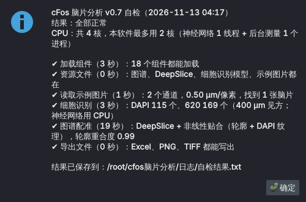

自检不会影响任何项目。结果同时保存在日志文件夹的“自检结果.txt”里。如果有 ✘，请点同一页的「出问题时：导出诊断包（发给开发者）…」，把生成的 zip 文件发给负责维护软件的同学或老师（见 17.3 节）。

# 第 2 章 认识界面

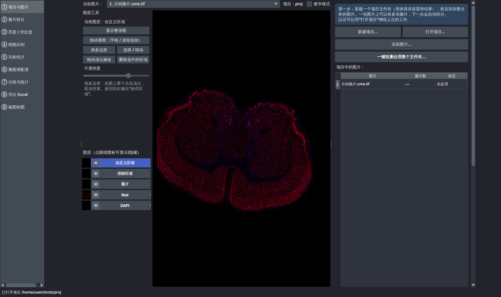

软件窗口分成 5 个部分：

| 位置 | 名称 | 作用 |
|---|---|---|
| 最左侧 | 步骤列表 | ① 到 ⑨ 九个步骤，点一下切换到那一步。开着教学模式时，完成的步骤后面会打勾 ✓。没有添加图片之前，②–⑨ 是灰色的，点不了 |
| 顶部 | 当前图片 | 下拉框选择要查看的图片；右边显示当前项目名称和“教学模式”勾选框 |
| 中间左 | 图层工具、图层列表 | 图层工具会根据你选中的图层变化（例如画方框、画多边形、加点）；图层列表里点眼睛图标可以显示 / 隐藏某个图层 |
| 中间 | 看图窗口 | 显示图片、细胞、脑区边界等 |
| 最右侧 | 操作面板 | 当前步骤的所有按钮和参数。内容多时可以上下滚动 |
| 最底部 | 状态栏 | 显示提示和进度。运行较长的任务时右下角有进度条和“取消”按钮；平时还显示软件使用了多少 CPU 核心 |

## 2.1 看图窗口的鼠标操作

| 操作 | 方法 |
|---|---|
| 放大 / 缩小 | 鼠标滚轮 |
| 移动图片 | 按住鼠标左键拖动（需要在“拖动看图”模式下，见图层工具） |
| 回到整张图 | 点图层工具里的「显示整张图」 |
| 显示 / 隐藏某个图层 | 在图层列表里点该图层前面的眼睛图标 |
| 调图层透明度 | 选中图层后拖动图层工具里的“不透明度”滑块 |

图层列表里常见的图层有：每个通道的图像（DAPI、Red 等）、“脑片”（黄色方框）、“细胞-Red”这类识别结果、“脑区轮廓”（配准后的脑区边界）、“排除区域”“自定义区域”“截图框”等。

> 提示：在图上画东西（画方框、画多边形、加点）时，图层工具会切换到对应模式，这时拖动鼠标是在画图而不是移动图片。想移动图片时，点图层工具里的「拖动看图（平移 / 滚轮缩放）」。

## 2.2 长任务、取消和自动保存

识别、配准、批量处理这类任务可能需要几分钟到几小时。运行时：

- 窗口底部显示进度条和当前在做什么；
- 可以随时点右下角的「取消」；
- **每张脑片做完就会马上保存**。取消、死机或者断电后，再点一次同样的按钮，软件会跳过已经做完的脑片，从没做完的地方继续；
- 同一时间只能运行一个任务。前一个没完成时点别的按钮，会提示“上一个任务还在运行”。

所有设置和结果都自动保存在项目文件夹里，可以随时关掉软件，下次用“打开项目”继续。

## 2.3 教学模式

窗口右上角的「教学模式」勾选后，每一步的右侧面板顶部会多一个“📘 本步要点（教学模式）”框，包括这一步的目标、做法、常见错误，以及正确 / 错误的参考图（点小图可以放大）。

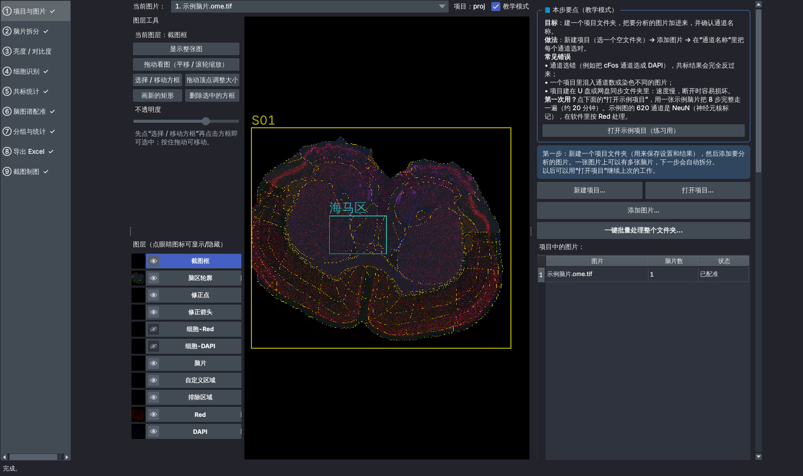

熟悉以后可以取消勾选，面板会更简洁。这个设置会被记住。

# 第 3 章 第一次练习：示例项目（约 20 分钟）

软件自带一张示例脑片，并附有“参考答案”。建议每个新同学先用它完整练习一遍。

1. 勾选窗口右上角的「教学模式」。
2. 在“① 项目与图片”页面，教学模式的要点框里点「打开示例项目（练习用）」。
3. 选择一个放示例项目的位置（例如“桌面”或 D 盘）。软件会在里面新建“cFos示例项目”文件夹，把示例图片拷进去并打开。
4. 按左侧 ② → ⑧ 的顺序做一遍。每一步怎么做，见本说明书第 5–11 章。
5. 在“④ 细胞识别”中用默认参数识别，在“⑧ 导出 Excel”导出后，打开 Excel 的“按脑片汇总”表，和教学模式里写的参考答案对比：**DAPI+ 约 69,348 个，Red+ 约 36,701 个。你的结果在 ±5% 以内，就说明操作正确。**

> 注意：示例图只有 2 个通道。它的 620 通道染的是 NeuN（神经元核标记），在软件里按 Red 处理。你自己的数据可能有 3–4 个通道，做法完全一样。

# 第 4 章 ① 项目与图片

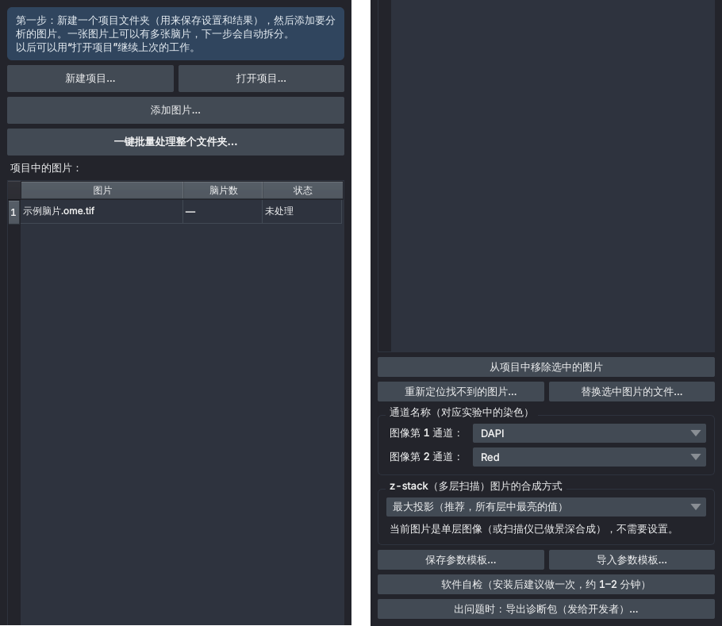

## 4.1 新建项目

一个实验建一个项目。项目文件夹用来保存设置和结果，原图不会被复制，也不会被修改。

1. 点「新建项目…」。
2. 选择（或新建）一个**空文件夹**作为项目文件夹，例如 `D:\cFos分析\2026-11电击实验`。
3. 软件会马上让你选择图片，见下一节。

> 注意：项目文件夹不要放在 U 盘、移动硬盘或网盘同步文件夹（OneDrive、百度网盘同步盘等）里。这些位置速度慢，断开或同步冲突时容易损坏项目。原图可以放在任何地方。

以后继续工作时，点「打开项目…」，选择项目文件夹即可。如果选择的文件夹里已经有项目，“新建项目”也会询问是否直接打开。

## 4.2 添加图片

1. 点「添加图片…」，可以一次多选。支持的格式：`.qptiff`、`.tif`、`.tiff`、`.ome.tif`、`.ome.tiff`。
2. 添加后，图片出现在“项目中的图片”表格里，表格有三列：图片、脑片数、状态（例如“已拆分 2 张脑片”“已识别细胞”“已配准”）。
3. 双击表格中的一行，可以切换到这张图片；也可以在窗口顶部的“当前图片”下拉框里切换。

注意事项：

- **同一个项目里的图片，通道数和染色方案必须一样。** 通道数不同的图片会被拒绝加入，并提示原因。
- 目前**不支持** Olympus 的 `.vsi` / `.ets` 格式。这类图片需要先用扫描仪自带的软件导出为 OME-TIFF 或 TIFF。
- 「从项目中移除选中的图片」只是从项目中去掉，不会删除原图。

## 4.3 确认通道名称（很重要）

添加第一张图片后，“通道名称（对应实验中的染色）”框里会列出“图像第 1 通道”“图像第 2 通道”…，每个后面有一个下拉框，可以选 DAPI、Green、Red、Far red。

软件会根据图片里记录的信息自动猜一次，**请一定核对**：

- 细胞核染色（DAPI / Hoechst）必须选 **DAPI**。软件靠它判断阳性细胞有没有细胞核；
- 其他通道按实际的荧光颜色选择。例如 c-Fos 用 Alexa 488 就选 Green，NeuN 用 Cy3 / 594 / 620 就选 Red，Cy5 / 647 就选 Far red。

> 注意：通道选错（例如把 c-Fos 通道选成 DAPI），共标结果会完全反过来。

## 4.4 z-stack（多层扫描）图片的合成方式

40 µm 左右的厚切片，有的同学用单层扫描，有的用扫描仪做景深合成（EDF），有的扫 z-stack。软件都支持：

- 单层扫描、扫描仪已经做过 EDF 的图片：不需要设置，这个选项对它们不起作用；
- z-stack 图片：读图时会自动合成为一层，可选三种方式：

| 合成方式 | 说明 | 什么时候用 |
|---|---|---|
| 最大投影（推荐，所有层中最亮的值） | 每个位置取所有层里最亮的值 | 大多数情况 |
| 景深合成（每处取最清晰的一层） | 每个位置取最清晰的那一层 | 背景雾比较重、最大投影看起来很“糊”时 |
| 平均投影 | 所有层取平均 | 需要和以前用平均投影的数据对比时 |

选中 z-stack 图片后，下方会显示“当前图片是 z-stack（N 层）”。改了合成方式后，已经识别过的图片需要重新识别才会使用新的方式。

## 4.5 参数模板

- 「保存参数模板…」：把识别、共标、亮度等所有参数存成一个 `.json` 文件；
- 「导入参数模板…」：在另一个项目里读入这些参数。

用途：同一个实验的数据分几批分析时，或者组里规定了统一参数时，用模板可以保证所有人、所有批次的分析标准一致。导入模板后，已识别的图片需要重新识别（如果只改了阈值类参数，点“④ 细胞识别”里的「按新阈值重新筛选」即可）。

## 4.6 其他按钮

- 「一键批量处理整个文件夹…」：见第 13 章；
- 「重新定位找不到的图片…」「替换选中图片的文件…」：项目换电脑或原图搬家后使用，见 16.3 节；
- 「软件自检」：见 1.5 节；
- 「出问题时：导出诊断包（发给开发者）…」：见 17.3 节。

# 第 5 章 ② 脑片拆分

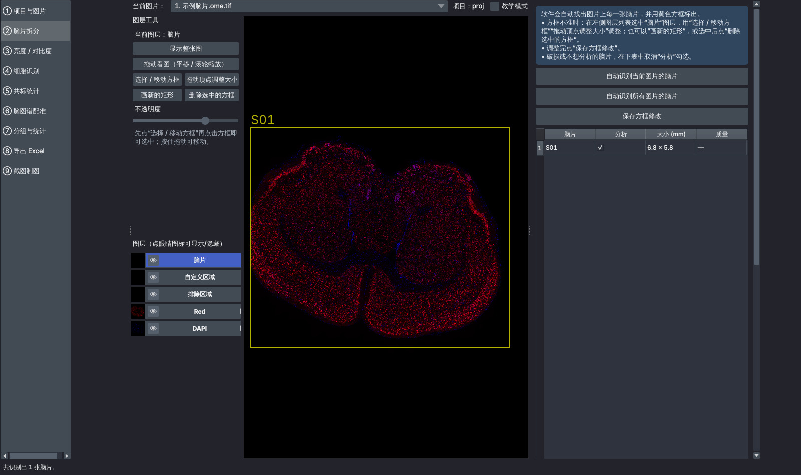

## 5.1 自动识别脑片

1. 点「自动识别当前图片的脑片」（只处理当前图片）或「自动识别所有图片的脑片」。
2. 每张脑片会被一个黄色方框框住，并按 S01、S02… 编号。
3. 下方表格列出每张脑片：脑片、分析（勾选框）、大小（mm）、质量。双击一行可以放大到这张脑片。

## 5.2 检查和调整方框

好的结果是：**每张脑片一个框，方框完整包住组织，四周留一点空白。** 常见问题和处理方法：

| 问题 | 处理 |
|---|---|
| 方框切掉了脑片边缘 | 在图层列表选中“脑片”图层，点图层工具「拖动顶点调整大小」，拖动方框的角 |
| 两张靠得很近的脑片被框进同一个框 | 选中这个框，点「删除选中的方框」，再用「画新的矩形」分别画两个 |
| 漏掉了一张脑片 | 点「画新的矩形」，在图上拖出方框 |
| 灰尘、碎片被当成了脑片 | 在表格里取消这一行的“分析”勾选，或删掉这个方框 |
| 破损严重、不想分析的脑片 | 在表格里取消“分析”勾选 |

**调整完一定要点「保存方框修改」**，否则修改不会生效。

## 5.3 排除区域和自定义区域

在“排除区域 / 自定义分析区域”框里：

- **排除区域**：切片上的折叠、气泡、撕裂、边缘异常发亮等地方。圈出来以后，区域内的细胞和面积都不计入统计，避免影响密度；
- **自定义区域**：不依赖脑图谱，自己圈出想统计的区域（例如某个注射位点周围）。导出的 Excel 中会多一张“按自定义区域”表。

画法：

1. 点「画排除区域」或「画自定义区域」；
2. 在图上逐个点击多边形的顶点，**双击结束**一个多边形；可以连续画多个；
3. 画错了：在图层工具里点「选择 / 移动」选中它，再点「删除选中的区域」；也可以用「拖动顶点修改」调整形状；
4. 画完点「保存区域」。

自定义区域会自动命名为“区域1”“区域2”…，在列表里双击可以改名（例如“注射点周围”）。排除区域和自定义区域在导出 Excel 时生效，**不需要重新识别细胞**。

## 5.4 检查所有脑片的质量

点「检查所有脑片的质量（模糊、过曝、缺损、配准）」，软件会自动检查每张脑片：

- 配准是否贴合（做完 ⑥ 配准后才有）；
- 有没有大片模糊（没对上焦）；
- 有没有过曝（亮度饱和）；
- 组织有没有撕裂或缺损；
- DAPI 细胞密度是否异常（可能识别失败）。

结果分为“正常 / 注意 / 可疑”，显示在表格的“质量”列（绿 / 黄 / 红底色），鼠标停在上面可以看到具体问题。检查完会弹出一个汇总窗口，按质量分从低到高排列，双击一行可以跳到这张脑片。

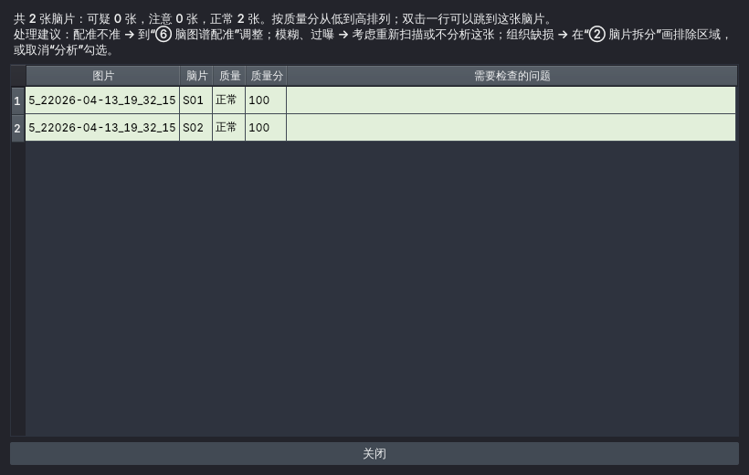

处理建议：

- 配准不准 → 到“⑥ 脑图谱配准”调整；
- 模糊、过曝 → 考虑重新扫描，或者不分析这张；
- 组织缺损 → 画排除区域，或者取消“分析”勾选。

第一次检查每张脑片约需 5–10 秒，之后有缓存。导出 Excel 和批量处理时也会自动做质量检查，“可疑”的脑片在 Excel 中标红、“注意”的标黄。

# 第 6 章 ③ 亮度 / 对比度

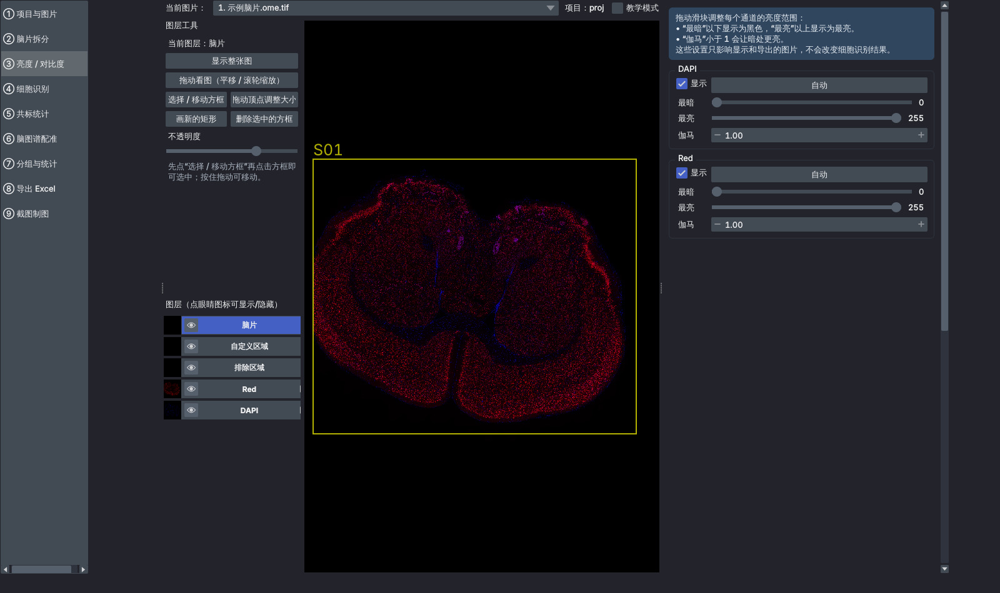

**这一步只影响显示和导出的图片，不会改变细胞识别和计数结果。**

每个通道有一组设置：

| 设置 | 作用 |
|---|---|
| 显示 | 勾掉后隐藏这个通道 |
| 自动 | 软件自动设置一个合适的范围。建议先点它，再微调 |
| 最暗 | 低于这个值的显示为黑色。调高可以压暗背景 |
| 最亮 | 高于这个值的显示为最亮。调低会让整体变亮 |
| 伽马 | 小于 1 时暗处变亮，大于 1 时暗处变暗 |

好的设置是：**细胞边界清楚，背景接近黑色。** 调得太亮，细胞连成一片，会误以为“识别漏了很多”；调得太暗，弱阳性细胞看不见。

> 提示：要做组间对比的图（例如对照组和实验组各截一张图），所有图片必须用同一套亮度设置，否则看起来的“差异”可能只是显示设置不同。

# 第 7 章 ④ 细胞识别

这是最重要的一步。软件对每个通道分别用 StarDist 深度学习模型找出细胞，再按你设定的标准（面积、亮度等）筛选出阳性细胞。不需要显卡。

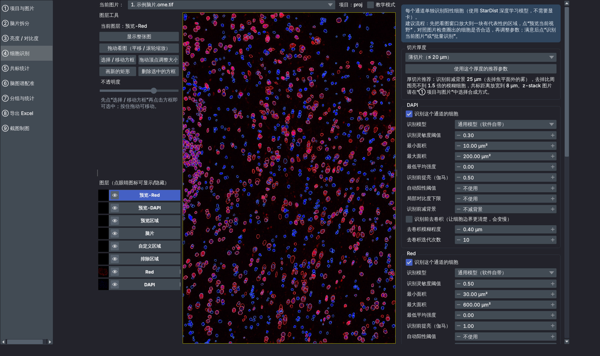

## 7.1 推荐的操作顺序

1. **选切片厚度**：在“切片厚度”框里选「薄切片（≤ 20 µm）」或「厚切片（30–50 µm，如 40 µm 漂片）」，点「使用这个厚度的推荐参数」。
2. **放大到一小块有代表性的区域**（视野里能看清一个个细胞即可）。
3. 点「预览当前视野的细胞识别」，几秒后，图上会用各通道颜色的轮廓圈出识别到的细胞，面板上会显示每个通道识别到多少个。
4. 对照原图检查：是不是每个细胞都被圈住了？有没有把背景、碎片圈进来？
5. 不满意就调整参数（见 7.2 节），再预览。**在亮的、暗的、细胞密集的三种区域各预览一次。**
6. 满意后，点「识别当前图片的全部脑片」或「批量识别项目中所有图片」。

识别结束后，面板下方会列出每张脑片每个通道的细胞数。

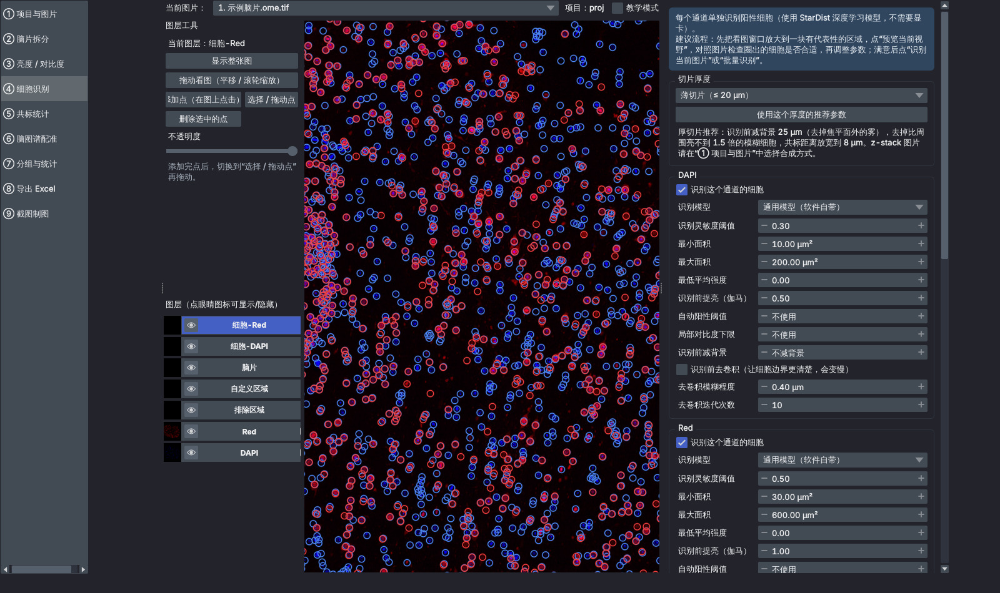

> 提示：视野太大时，预览只处理视野中央的一块（图上会用黄色虚线框标出），这是为了让预览只需要几秒。

## 7.2 每个通道的参数

面板中每个通道有一组参数（可以上下滚动查看）：

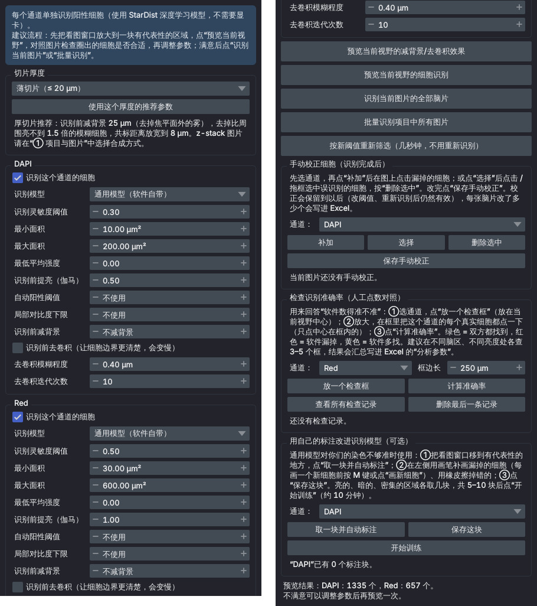

| 参数 | 作用 | 怎么调 | 改了以后 |
|---|---|---|---|
| 识别这个通道的细胞 | 勾掉则这个通道不识别 | 只关心部分通道时用 | 重新识别 |
| 识别模型 | 默认“通用模型（软件自带）”；用自己标注训练的模型会出现在这里 | 见 7.7 节 | 重新识别 |
| 识别灵敏度阈值 | 越小找到的细胞越多（包括暗的），越大越严格 | 默认 0.5，DAPI 默认 0.3。漏得多就调小，多圈了就调大，每次改 0.05–0.1 | 重新识别 |
| 最小面积 / 最大面积（µm²） | 面积不在这个范围的不算 | 去掉碎片调大最小面积；去掉粘连的大团调小最大面积 | 重新筛选即可 |
| 最低平均强度 | 细胞内平均亮度低于此值不算阳性，0 表示不限制 | 一般不用，优先用“自动阳性阈值” | 重新筛选即可 |
| 识别前提亮（伽马） | 小于 1 时暗的细胞更容易被识别，只影响识别不影响显示 | DAPI 建议 0.5（神经元的 DAPI 往往很暗） | 重新识别 |
| 自动阳性阈值（倍背景） | 细胞平均亮度至少是本脑片组织背景的多少倍才算阳性，0 表示不使用 | c-Fos 等活性标记推荐使用，例如 1.5–3 倍。**同一批实验用同一个值** | 重新筛选即可 |
| 局部对比度下限（倍周围） | 细胞亮度 ÷ 细胞外面一圈（3 µm 宽）的亮度。厚切片中焦平面外的模糊细胞和周围差别小，可以用它去掉 | 厚切片 1.3–1.8，厚切片预设为 1.5；0 表示不使用 | 重新筛选即可 |
| 识别前减背景（µm） | 识别前去掉大范围的雾状背景，只影响识别，亮度测量仍用原图 | 半径要比细胞大，一般 20–50 µm；厚切片预设 25 µm | 重新识别 |
| 识别前去卷积 | 让细胞边界更清楚，会变慢 | 细胞挤在一起、边界模糊时试试，见 7.3 节 | 重新识别 |
| 去卷积模糊程度（µm） | 图像的模糊程度 | 示例图建议 0.4 µm。太大会让细胞变成空心圆环 | 重新识别 |
| 去卷积迭代次数 | 迭代越多越锐利，也越慢 | 默认 10 | 重新识别 |

**“重新筛选即可”的参数**：改完点「按新阈值重新筛选（几秒钟，不用重新识别）」，几秒钟就能更新所有图片的结果。**“重新识别”的参数**（灵敏度、提亮、减背景、去卷积、换模型）改完需要再点一次识别。软件会自动跳过参数没有变化的脑片，所以只改了一个通道时不会全部重算。

两种切片厚度的推荐参数如下：

| | 薄切片（≤ 20 µm） | 厚切片（30–50 µm） |
|---|---|---|
| 识别前减背景 | 不减 | 25 µm |
| 局部对比度下限（非 DAPI 通道） | 不使用 | 1.5 |
| DAPI | 提亮 0.5，灵敏度 0.3 | 提亮 0.5，灵敏度 0.3 |
| 共标距离 | 6 µm | 8 µm |

## 7.3 去卷积和减背景：先预览效果

点「预览当前视野的减背景/去卷积效果」，软件会把当前视野处理后的图像作为新图层（名字以“预处理-”开头）叠加显示。在图层列表里点眼睛图标切换，可以和原图对比。

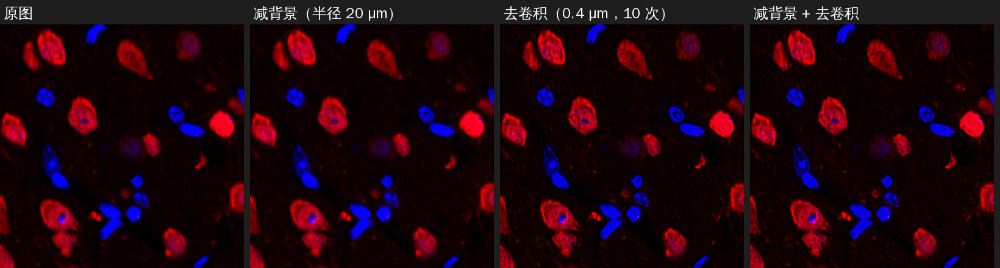

使用建议：

- 一般数据**不需要**去卷积，默认关闭；
- 细胞挤在一起、软件把相邻细胞识别成一个时，可以试试去卷积；
- 背景雾很重（厚切片、z-stack 最大投影）时，先试“识别前减背景”；
- 去卷积会让识别变慢（大约慢 1 倍或更多）。

## 7.4 识别结果怎么看

识别完成后，每个通道的阳性细胞以“细胞-通道名”图层显示（圆圈）。可以：

- 在图层列表点眼睛图标，只看一个通道；
- 放大到各个脑区抽查；
- 用 7.6 节的“准确率检查”定量评估。

## 7.5 手动校正细胞

自动识别不可能 100% 准确。对于重要的脑片（例如论文主图用的脑片），可以手动补加和删除：

1. 在“手动校正细胞（识别完成后）”框里选择通道。
2. 点「补加」，然后在图上点击漏掉的细胞中心，每点一下加一个。
3. 点「选择」，然后点击误识别的细胞（或按住鼠标拖框选中多个），点「删除选中」。
4. 改完点「保存手动校正」。

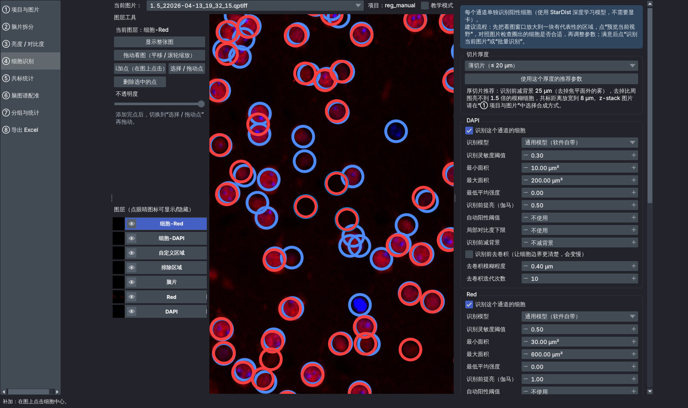

手动校正会一直保留：之后改阈值、重新识别，校正仍然有效。每张脑片补加、删除了多少个会写进 Excel，方便在论文方法部分说明。

## 7.6 检查识别准确率（人工点数对照）

这个工具用来回答“软件数得准不准”，结果可以直接写进论文的方法部分。

1. 在“检查识别准确率（人工点数对照）”框里选择通道，设置“框边长”（默认 250 µm）。
2. 把要检查的区域移到视野中心，点「放一个检查框」。视野中心会出现一个青色方框，软件的识别结果暂时隐藏，以免影响你判断。
3. 放大，在框里把这个通道的**每个真实细胞**都点一下（只点中心在框内的）。点错了：在图层工具里切到「选择 / 拖动点」，选中后点「删除选中的点」。
4. 点「计算准确率」。

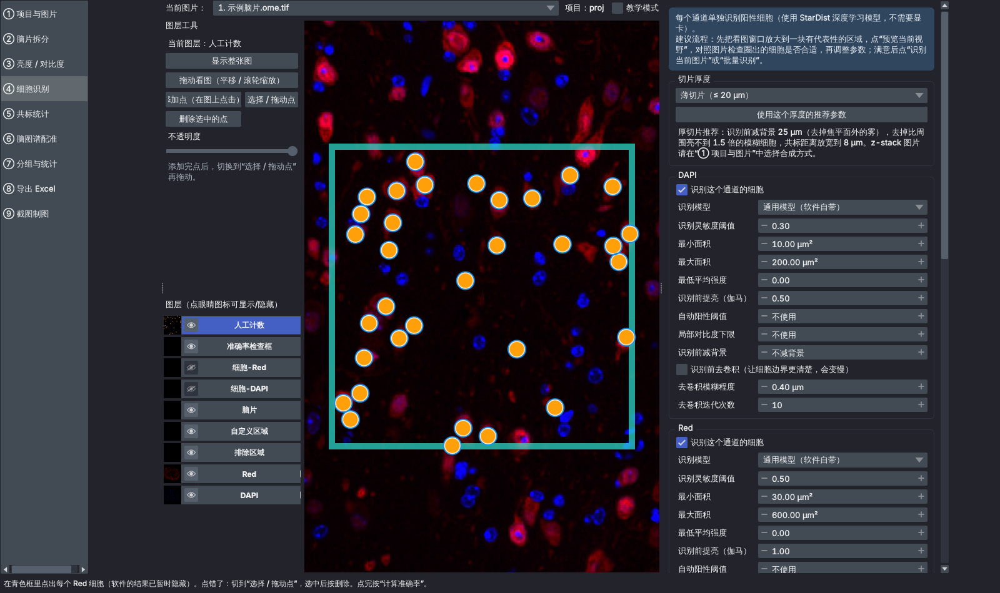

软件把你点的位置和自动识别的细胞配对（距离 ≤ 6 µm 算同一个细胞），给出三个指标：

| 指标 | 意思 |
|---|---|
| 查准率 | 软件找到的细胞里，有多少是真的 |
| 查全率 | 真的细胞里，软件找到了多少 |
| F1 | 两者的综合，越接近 1 越好 |

图上绿色表示双方都找到，**红色表示软件漏掉的，黄色表示软件多找的**。

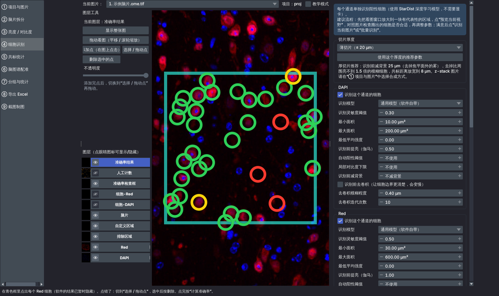

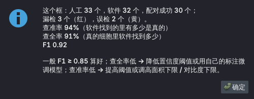

怎么判断：

- 一般 **F1 ≥ 0.85** 算好；
- 查全率低（漏得多）→ 降低“识别灵敏度阈值”，或用自己的标注微调模型（7.7 节）；
- 查准率低（多找了）→ 提高“识别灵敏度阈值”，或调大最小面积 / 局部对比度下限。

建议在不同脑区、不同亮度的地方各查 3–5 个框。所有检查记录保存在项目里，「查看所有检查记录」可以看全部明细，「删除最后一条记录」可以删掉点错的那次。各通道的累计结果会写进 Excel 的“分析参数”表。

## 7.7 用自己的标注改进识别模型（可选）

如果调参数后准确率仍然不理想（例如你们的染色很特别），可以用自己的标注“微调”识别模型。整个过程在 CPU 上完成，训练约 10 分钟。

1. 在“用自己的标注改进识别模型（可选）”框里选通道。
2. 把看图窗口移到有代表性的地方，点「取一块并自动标注」。软件会取视野中的一小块，先自动圈出细胞，每个细胞一种颜色（“标注块”图层）。
3. 修改标注（图层工具会切换为画笔工具）：
   - 漏掉的细胞：按 **M 键**（或点「画新细胞（M 键）」）换一个新颜色，然后用画笔涂满这个细胞；
   - 画错的地方：用「橡皮擦」擦掉；
   - 整个错误的细胞：点「删除点中的细胞」，再点那个细胞；
   - 「画笔变大」「画笔变小」调整画笔。
4. 改完点「保存这块」。
5. 在亮的、暗的、细胞密集的区域各取几块，**共 5–10 块**（至少 3 块）。
6. 点「开始训练」。

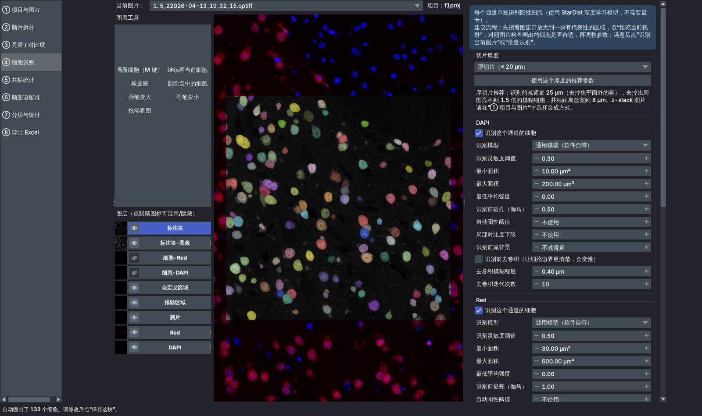

训练完成后，软件会在留出的标注块上比较训练前后的准确率（F1）。如果新模型更好，会询问是否让这个通道使用新模型；使用后需要重新识别。新模型会出现在该通道的“识别模型”下拉框里，名称后面标注了训练前后的准确率。如果新模型没有明显变好，软件会建议继续用原来的模型，或者多标注几块、覆盖更多不同的区域后再训练。

# 第 8 章 ⑤ 共标统计

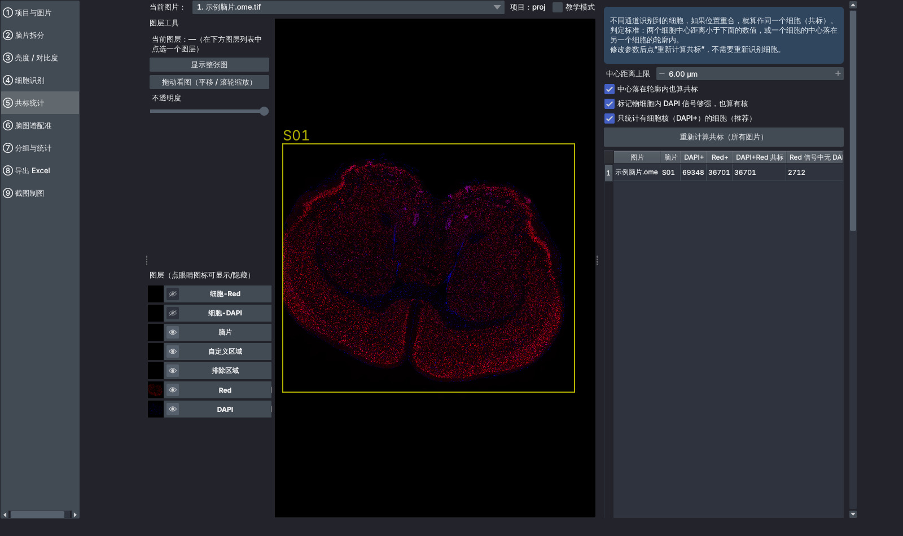

不同通道识别到的细胞，如果位置重合，就算作同一个细胞（共标）。判定标准：两个细胞中心的距离小于“中心距离上限”，或者一个细胞的中心落在另一个细胞的轮廓内。

## 8.1 参数

| 参数 | 默认 | 说明 |
|---|---|---|
| 中心距离上限 | 6 µm（厚切片 8 µm） | 太大会把相邻的两个细胞当成共标 |
| 中心落在轮廓内也算共标 | 勾选 | 大细胞（如神经元胞体）和小细胞核的中心可能离得较远，勾选后更准确 |
| 标记物细胞内 DAPI 信号够强，也算有核 | 勾选 | 有些神经元的 DAPI 很暗，DAPI 通道没识别出来，但细胞内 DAPI 信号确实存在，也算它有核 |
| 只统计有细胞核（DAPI+）的细胞（推荐） | 勾选 | 切片切到胞体边缘时，会出现没有细胞核的信号碎片。勾选后这些不计入细胞数，但会在 Excel 中单独列出数量（列名会写明是哪个通道的“无核”信号） |

一般使用默认值即可。修改参数后点「重新计算共标（所有图片）」，几秒钟完成，**不需要重新识别细胞**。

## 8.2 阳性细胞强度分级（弱 / 中 / 强）

有时需要区分“强阳性”和“弱阳性”细胞（例如比较强 c-Fos 表达的细胞数）。强度 = 细胞平均亮度 ÷ 该脑片组织背景（倍）。

1. 在“阳性细胞强度分级”框里选通道，勾选「对这个通道分级」；
2. 设置“弱 / 中 分界”和“中 / 强 分界”（单位：倍背景）。不知道设多少时，可以点「按全部细胞三等分建议」，软件会按所有细胞的强度分成数量相等的三份；
3. 点「应用并画分布图」。软件会画出强度分布直方图（保存在项目 results 文件夹，名为“强度分布_通道名.png”）。

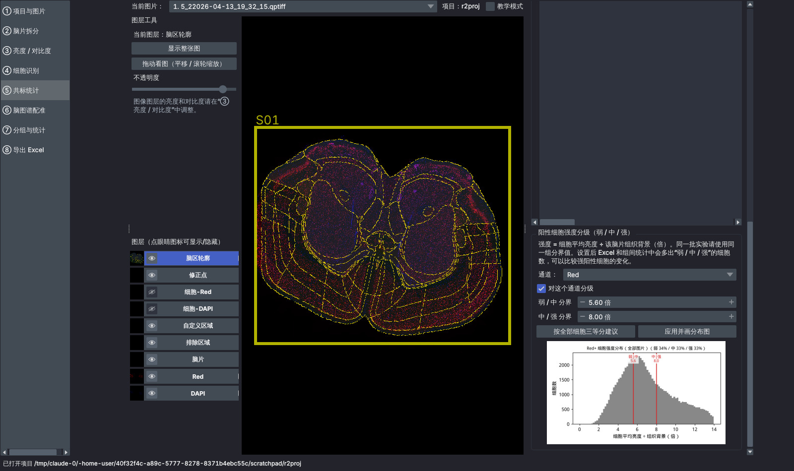

设置后，Excel 和组间统计中会多出“弱 / 中 / 强”的细胞数。

> 注意：分界值应该在**整个实验中保持一致**。不要每批数据各自“三等分”，否则不同批次之间不可比。

# 第 9 章 ⑥ 脑图谱配准

配准就是把每张脑片对齐到 Allen 小鼠脑图谱（CCFv3），这样软件才知道每个细胞属于哪个脑区。这一步需要你的判断，请认真检查每一张脑片。

## 9.1 自动配准

1. 确认勾选「自动配准后做非线性贴合（推荐）」。
2. 点「自动配准当前图片的全部脑片」或「自动配准项目中所有图片」。

软件会自动完成：

- 判断每张切片在大脑中的前后位置（Bregma）和切面角度（使用 DeepSlice）；
- 判断切片是不是倒着贴在玻片上的（试 0° 和 180°，选与图谱轮廓重合最好的方向）；
- 非线性贴合：让图谱的外轮廓和内部结构（利用 DAPI 图像的纹理，例如纤维束、脑室）与组织对齐。如果贴合出现异常，软件会自动退回只用外轮廓的方法。

每张脑片大约需要 20–60 秒。

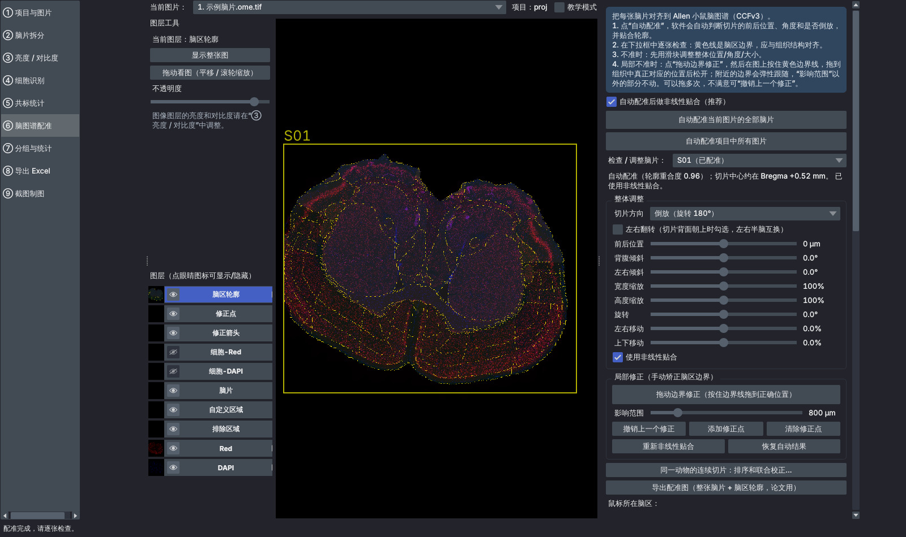

## 9.2 逐张检查

在“检查 / 调整脑片”下拉框中逐张选择脑片。黄色线是图谱的脑区边界，状态栏会显示“切片中心约在 Bregma ±x.xx mm”。把鼠标移到图上，面板底部会显示“鼠标所在脑区：缩写（全名），左/右半脑”。

检查顺序：

1. **前后位置对不对**：看 Bregma 数值和脑片的形状是否相符（例如有没有海马、有没有前连合）；
2. **外轮廓**：黄色外轮廓是否贴合组织边缘；
3. **内部结构**：胼胝体、前连合、海马、脑室等结构是否与边界线吻合。

> 注意：只看外轮廓是不够的。外轮廓对上了，脑区仍然可能整体错位。一定要看内部结构。

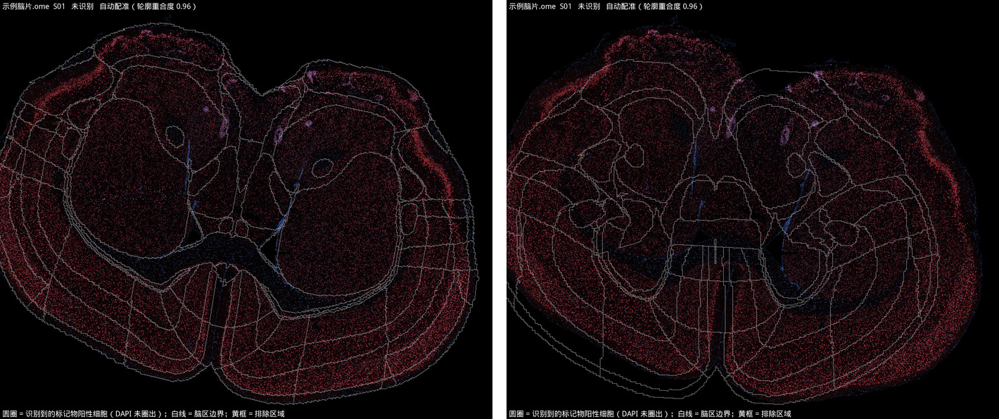

## 9.3 整体调整

整体位置、角度、大小不对时，在“整体调整”框里用滑块调整：

| 滑块 / 选项 | 作用 |
|---|---|
| 切片方向 | 正放（背侧朝上）/ 倒放（旋转 180°）。自动判断错了时手动改 |
| 左右翻转 | 切片背面朝上贴片时勾选，左右半脑互换 |
| 前后位置 | 每格 25 µm，调整切片对应图谱中的哪个冠状面 |
| 背腹倾斜、左右倾斜 | 切面角度（°）。切片不是完全的冠状面时调整 |
| 宽度缩放、高度缩放 | 组织收缩或膨胀时调整 |
| 旋转 | 整体旋转（°） |
| 左右移动、上下移动 | 整体平移 |
| 使用非线性贴合 | 勾选后在整体调整的基础上再做局部贴合 |

建议先调前后位置，再调倾斜，最后调缩放和平移。调整后状态会变成“已手动调整”。调整了整体参数后，可以点「重新非线性贴合」重新贴合；调乱了可以点「恢复自动结果」。

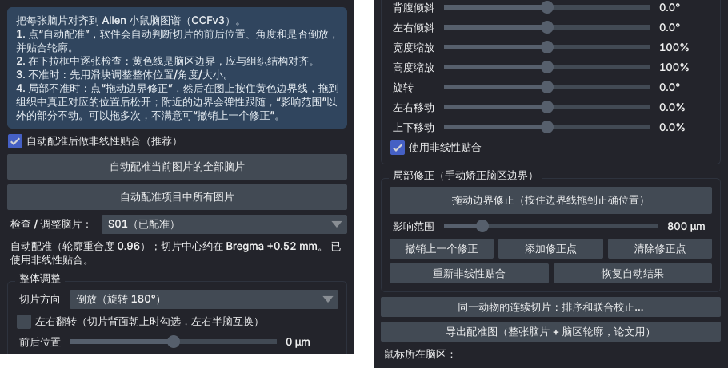

## 9.4 拖动边界修正（手动矫正局部脑区边界）

整体对齐了，但某个局部（例如海马的一段边界）还差一点时，用拖动修正：

1. 点「拖动边界修正（按住边界线拖到正确位置）」，按钮变为按下状态。
2. 用滑块设置“影响范围”（200–4000 µm，默认 800 µm）：拖动一个点时，距离它多远以内的边界会跟着动。**小结构用小范围，大面积偏移用大范围。**
3. 在图上**按住黄色边界线**（在线上或旁边一点按下都可以，软件会吸附到最近的边界），拖到组织中真正对应的位置后松开。拖动时会显示一条青色线（拖动方向）和一个圆（影响范围）。
4. 松开后，附近的边界会弹性跟随，影响范围以外的部分完全不动。
5. 可以拖多次。不满意时点「撤销上一个修正」，或「清除修正点」全部重来。
6. 改完再点一次按钮退出拖动模式（退出后鼠标才能正常平移图片；拖动模式下滚轮仍可缩放）。

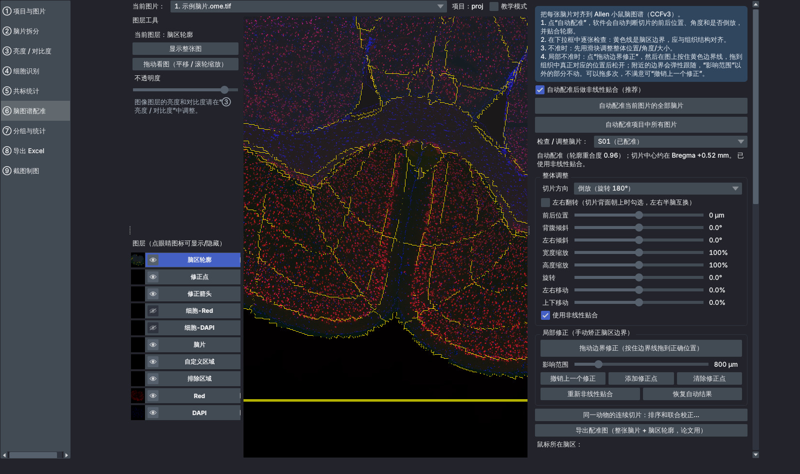

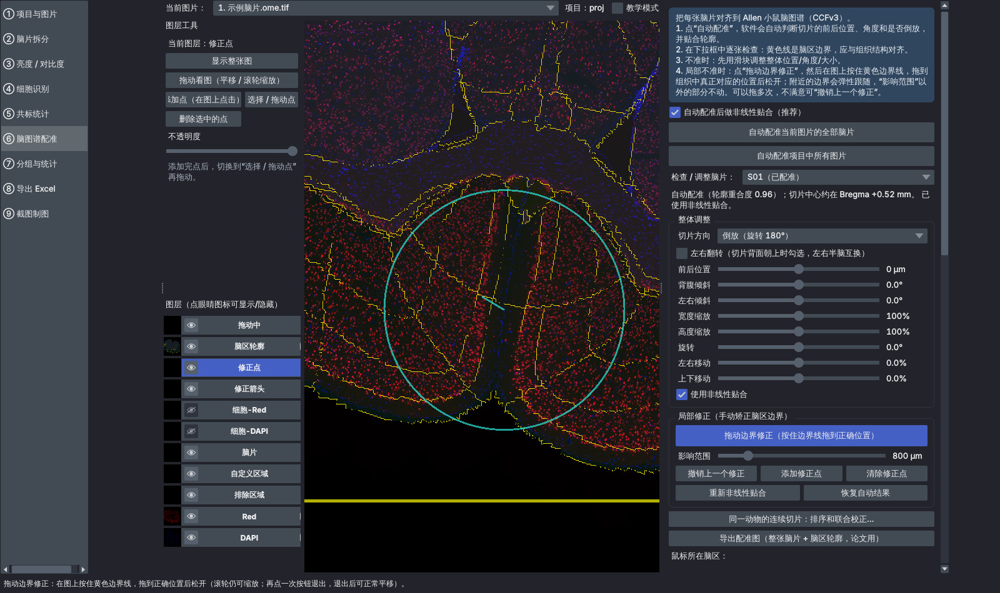

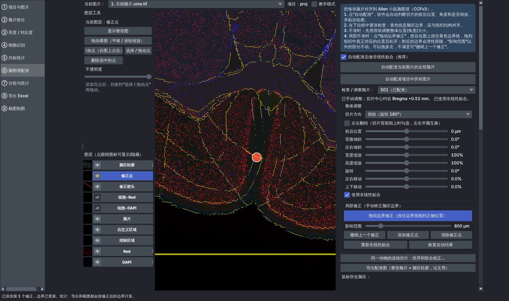

修正保存在项目里，脑区统计、Excel、质控图、截图制图都会按修正后的边界计算。

另一种方式：点「添加修正点」，在需要修正的边界线上点一下加点，然后在图层工具切到选择模式（或按 S 键），把点拖到正确位置。

## 9.5 同一动物的连续切片：排序和联合校正

同一个大脑的切片是用同一个角度切的。点「同一动物的连续切片：排序和联合校正…」，打开对话框：

1. 在“动物”下拉框选择动物（动物编号在“⑦ 分组与统计”中填写；没填的按图片分组）。表格按前后位置从前到后列出这只动物的所有切片，以及 Bregma、左右倾斜、背腹倾斜。
2. 勾选「统一切面角度（推荐）」：把这只动物所有切片的倾斜角度统一为中位数，去掉单张切片的角度误差，前后位置不变。
3. “切片间距”：如果知道相邻两张切片的实际间距，填进去（例如 40 µm 切片每 4 张取 1 张 = 160 µm），软件会让前后位置等间距排列；不确定就保持“不调整”。
4. 勾选「校正后重新做非线性贴合（推荐，约每张 10 秒）」。
5. 点「应用联合校正」。不满意可以点「撤销联合校正」。

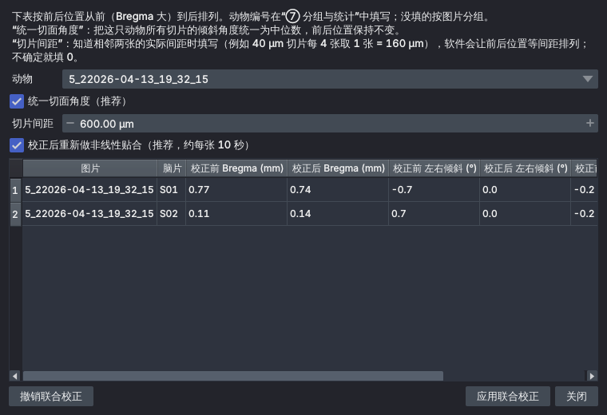

## 9.6 导出配准图（论文用）

点「导出配准图（整张脑片 + 脑区轮廓，论文用）」，会为当前图片每张已配准的脑片导出一张图：荧光 + 脑区轮廓 + 缩写 + 比例尺。线条颜色、通道、分辨率、格式等在“⑨ 截图制图”里设置，详见 12.5 节。

# 第 10 章 ⑦ 分组与统计

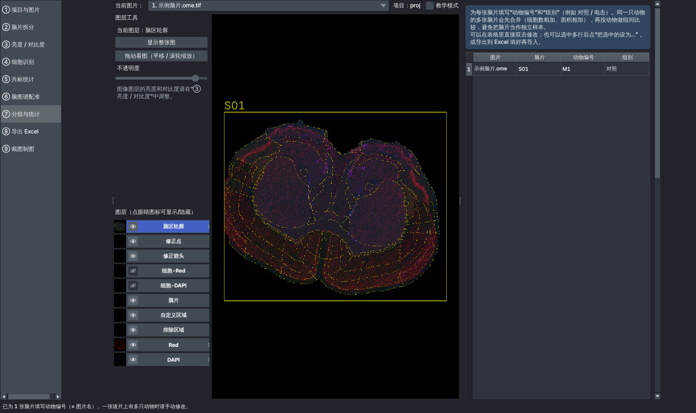

## 10.1 填写动物编号和组别

为每张脑片填写“动物编号”和“组别”（例如“对照”“电击”）。同一只动物的多张脑片会先合并（细胞数相加、面积相加），再按动物做组间比较，**避免把脑片当作独立样本**（这是审稿人常问的问题）。

填写方法（任选一种）：

- 在表格里直接双击单元格修改；
- 按住 Ctrl 或 Shift 选中多行，点「选中的设为同一组…」或「选中的设为同一动物…」；
- 一张玻片就是一只动物时，点「动物编号=图片名」，自动用图片名作为动物编号；
- 脑片很多时，点「导出分组表…」，在 Excel 里填写“动物编号”和“组别”两列（**不要修改“图片”和“脑片”两列**），保存后点「导入分组表…」。

> 注意：动物编号的写法要统一。“M1”和“m1”、全角和半角字符会被当成不同的动物，软件发现只差大小写或全角半角时会提醒。同一只动物填进了两个组，软件会报错。

## 10.2 组间比较

在“组间比较”框里设置：

| 设置 | 说明 |
|---|---|
| 比较的指标 | 例如“Red+ 密度 (个/mm²)”“Green+Red 共标 密度”“Green+Red 共标 占 Red+ 的比例 %”。做了强度分级的通道还有“强阳性”等指标 |
| 统计方法 | Welch t 检验：常用，允许两组方差不同。Mann-Whitney U（非参数）：动物数少或数据明显偏态时用 |
| 对照组 | 其他组都和它比较 |
| 半脑 | 左右合计 / 左 / 右 |
| 最小面积（mm²） | 某只动物在某个脑区的总面积小于这个值时，这只动物不纳入该脑区的比较（面积太小密度不稳定） |
| 脑区范围 | 只比较到第几级脑区。脑区越细，比较次数越多，多重比较校正越严格；只关心大脑区时可以设 6–8 |

点「计算组间统计并画图」。结果保存在项目文件夹的“组间统计_日期时间”文件夹里，包括：

- 组间统计.xlsx：每个脑区每组的均值、标准误、p 值、**q 值（FDR 校正后）**、倍数变化等；
- 火山图、柱状图：每个比较一张；
- 脑区热图.png：各组平均密度和组间倍数变化，画回 CCF 冠状切面上（只给显著的脑区上色）。

点「打开统计结果文件夹」可以直接查看。

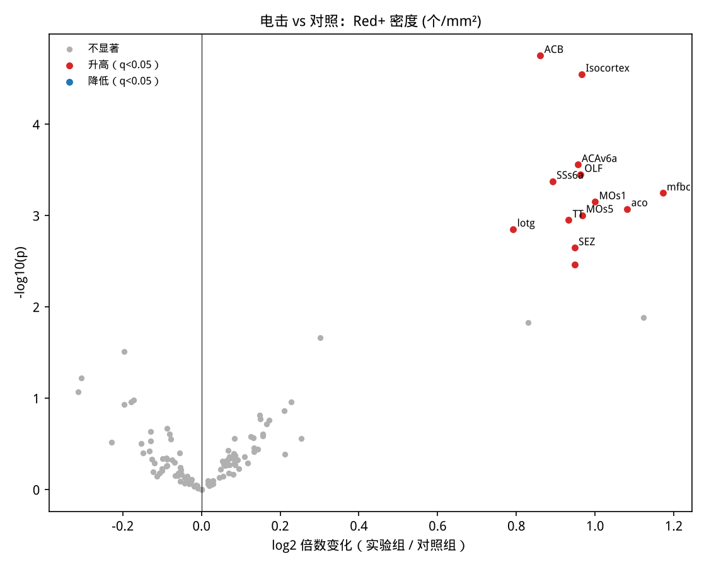

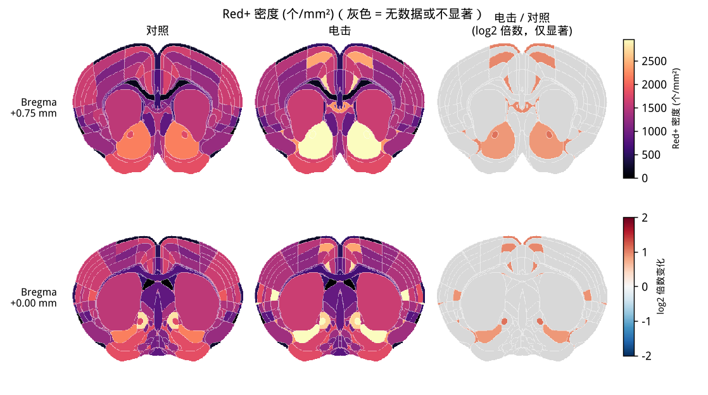

> 注意：脑区很多，必须看 q 值（FDR 校正后），不能只看 p 值。每组至少 3–4 只动物。

## 10.3 脑区功能网络分析（共激活网络）

功能网络分析看的是“哪些脑区的 c-Fos 一起升高或降低”：在每个组内，以动物为样本，计算脑区之间 c-Fos 的相关；强相关的脑区连成网络，再比较两组网络的结构（枢纽脑区、模块、网络密度等）。指标、半脑、最小面积沿用上面“组间比较”的设置。

| 设置 | 说明 |
|---|---|
| 脑区粒度：第几级 | 数字越大脑区分得越细（节点越多）。一般 6–8；节点数最好不要远多于动物数的 10 倍 |
| 相关方法 | Pearson 相关；Spearman 秩相关（对离群值更稳） |
| 主阈值 r ≥ | 画网络图和判断枢纽脑区用的阈值。软件另外还会在 0.5–0.9 的多个阈值下计算，看结论是否一致 |
| 只用正相关建网（常用做法） | 默认勾选 |
| 置换次数 | 组间比较的置换检验次数，越多 p 值越精确也越慢（1000 次一般 1 分钟以内） |

点「计算功能网络并画图」，结果保存在“功能网络_日期时间”文件夹：网络分析.xlsx、网络图.png、相关矩阵.png、阈值曲线.png。

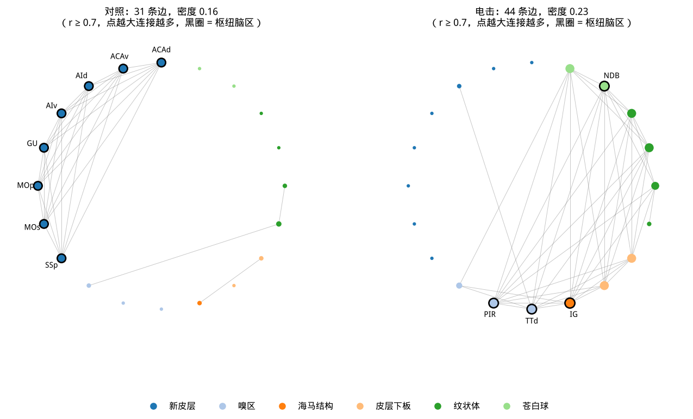

> 注意：**每组至少需要 4 只动物，建议 ≥ 8 只。** 动物少时结果不稳定，请重点报告在多个阈值下都一致、留一法检验也稳定的结论，不要只挑一个阈值下“好看”的结果。

# 第 11 章 ⑧ 导出 Excel

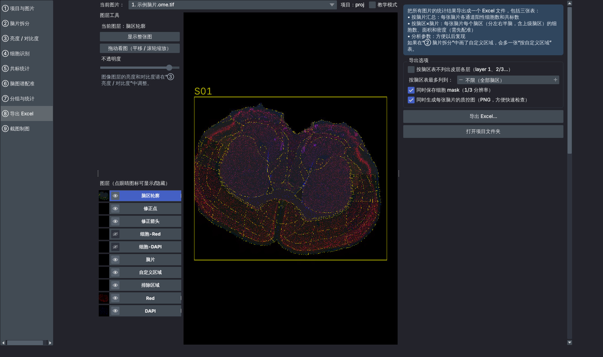

## 11.1 导出选项

| 选项 | 说明 |
|---|---|
| 按脑区表不列出皮层各层（layer 1、2/3…） | 勾选后，皮层只列到脑区（例如 MOp），不再按层拆分 |
| 按脑区表最多列到：第 N 级 | 例如 5 级大约到“Isocortex / 海马 / 丘脑”这一层，7–8 级到具体脑区。细胞数已经包含所有下级脑区，所以少列几级不会漏数 |
| 同时保存细胞 mask（1/3 分辨率） | 每张脑片每个通道一个细胞掩膜图，可以用其他软件进一步分析 |
| 同时生成每张脑片的质控图（PNG，方便快速检查） | 推荐勾选 |

点「导出 Excel…」，选择保存位置（默认是项目文件夹里的“细胞统计结果.xlsx”）。

> 注意：导出前请关闭同名的 Excel 文件，否则无法写入。

## 11.2 Excel 里有哪些表

| 表 | 内容 |
|---|---|
| 按脑片汇总 | 每张脑片一行：各通道阳性细胞数、各种共标数、无核信号数、组织面积、质量检查结果（“可疑”标红、“注意”标黄）、手动校正数量等 |
| 按脑区×脑片 | 每张脑片每个脑区（分左右半脑，包含所有上级脑区）的细胞数、面积（mm²）和密度（个/mm²）。需要先完成配准 |
| 分析参数 | 所有参数：软件版本、识别引擎、各通道用的识别模型和参数、共标参数、每张脑片的配准方法、准确率检查汇总等。写论文方法部分和以后复查时用 |
| 按自定义区域 | 只有在“② 脑片拆分”中画了自定义区域时才出现 |

## 11.3 导出后先做两件事

1. 看“按脑片汇总”表中**标红、标黄**的脑片，回到软件里检查；
2. 翻一遍“质控图_Excel文件名”文件夹（例如“质控图_细胞统计结果”）。每张脑片一张图，叠加了识别到的细胞、脑区边界和排除区域，几秒钟一张就能看出识别和配准是否正常。

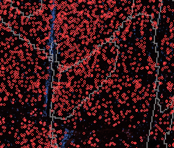

导出的文件：

- Excel 文件；
- “细胞mask_Excel文件名”文件夹（如果勾选了），例如“细胞mask_细胞统计结果”；
- “质控图_Excel文件名”文件夹（如果勾选了），例如“质控图_细胞统计结果”。

点「打开项目文件夹」可以直接查看。

# 第 12 章 ⑨ 截图制图

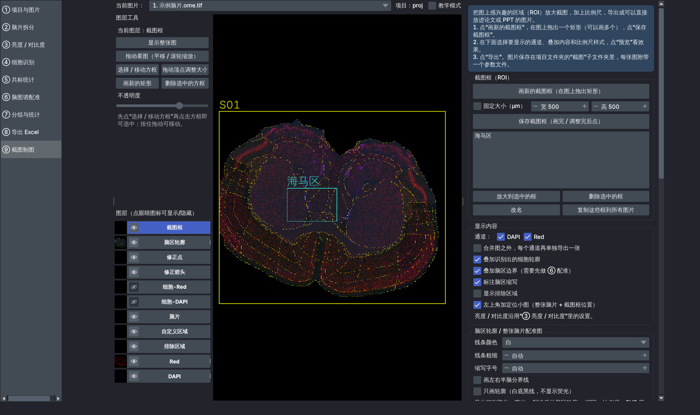

把感兴趣的区域（ROI）放大截图，加上比例尺，导出成可以直接放进论文或 PPT 的图片。亮度 / 对比度沿用“③ 亮度 / 对比度”里的设置，所以**先在 ③ 里调好亮度再截图**。

## 12.1 画截图框

1. 点「画新的截图框（在图上拖出矩形）」，在图上按住鼠标拖出一个矩形。可以画多个。
2. 需要固定大小时，勾选「固定大小（µm）」并填写宽、高。保存时每个框会以框中心为准调整成这个大小，方便不同图片之间比较。
3. 点「保存截图框（画完 / 调整完后点）」。

截图框列表中：双击名称可以改名（例如“海马区”），双击编号放大到这个框；「放大到选中的框」「删除选中的框」「改名」分别对应这些操作。「复制这些框到所有图片」会按相对于脑片的位置，在其他图片的每张脑片上加同样大小的框；复制后请到各张图片上检查位置。

## 12.2 显示内容

- 通道：勾选要显示哪些通道；
- 「合并图之外，每个通道再单独导出一张」；
- 「叠加识别出的细胞轮廓」；
- 「叠加脑区边界（需要先做 ⑥ 配准）」和「标注脑区缩写」；
- 「显示排除区域」；
- 「左上角加定位小图（整张脑片 + 截图框位置）」。

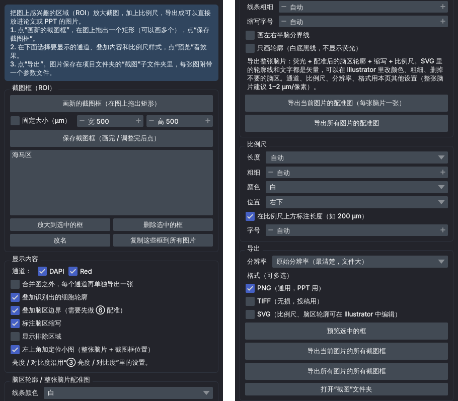

## 12.3 比例尺

| 设置 | 说明 |
|---|---|
| 长度 | 自动（约为图宽的 1/5，取整到 50 / 100 / 200 / 500 µm），也可以选择或直接输入数字（µm） |
| 粗细 | 自动或指定像素数 |
| 颜色 | 白 / 黑 |
| 位置 | 右下 / 左下 / 右上 / 左上 |
| 在比例尺上方标注长度（如 200 µm） | 勾选后显示文字 |
| 字号 | 自动或指定像素数 |

## 12.4 预览和导出

- 分辨率：原始分辨率（最清楚，文件大）、0.5 / 1 / 2 µm/像素、4 µm/像素（缩略）；
- 格式（可多选）：PNG（通用，PPT 用）、TIFF（无损，投稿用）、SVG（比例尺、脑区轮廓可在 Illustrator 中编辑）；
- 「预览选中的框」：弹出预览窗口，并显示实际导出的像素尺寸、µm/像素和比例尺长度；
- 「导出当前图片的所有截图框」或「导出所有图片的所有截图框」。

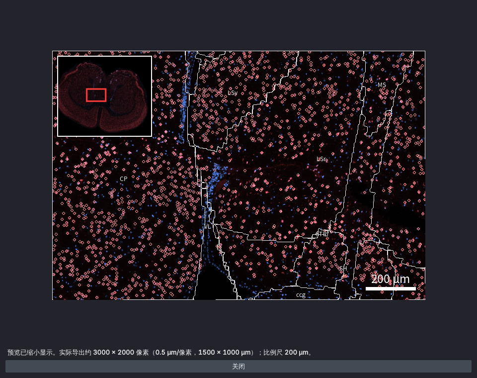

图片保存在项目文件夹的“截图”子文件夹里，点「打开“截图”文件夹」可以查看。每张图都附带一个同名的参数文件（.json），记录了位置、µm/像素和框内各通道的细胞数。

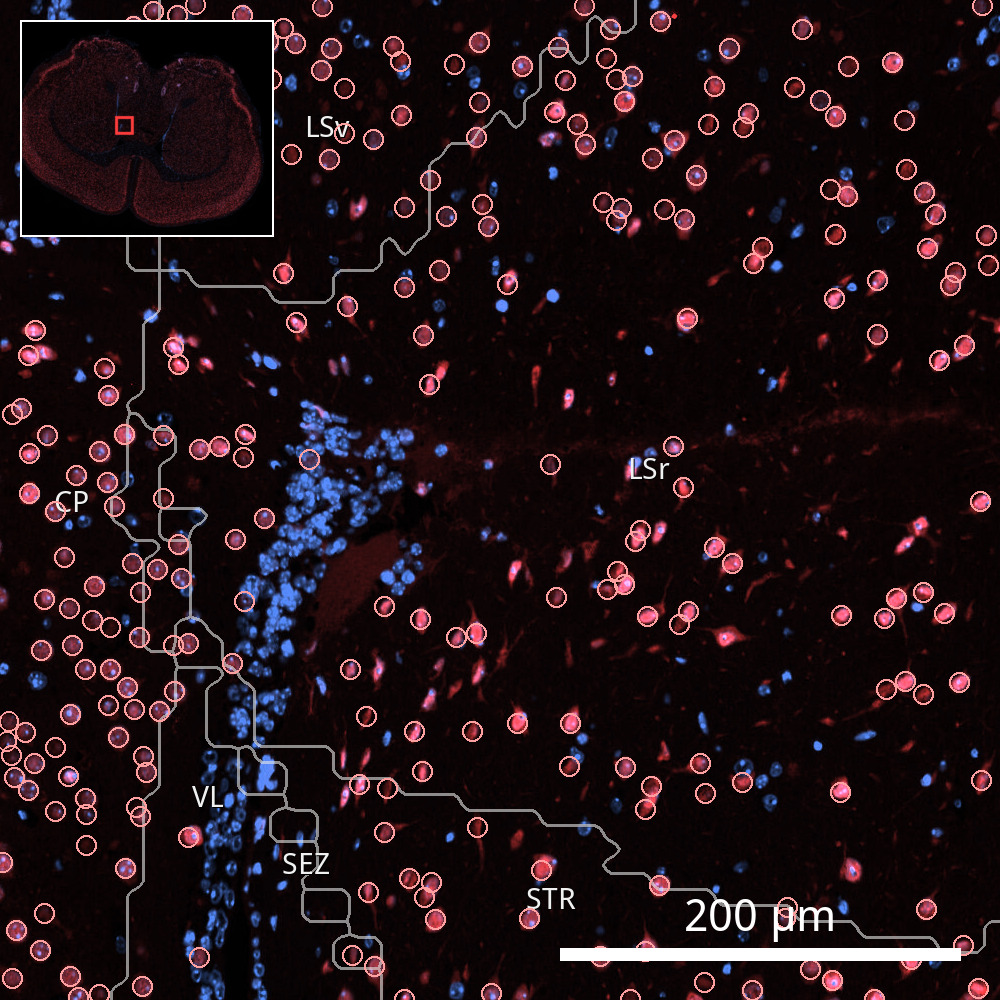

> 提示：同一篇论文里的图，建议用同一个比例尺长度和同样大小的截图框；所有分组的图用相同的亮度设置。

## 12.5 脑区轮廓 / 整张脑片配准图

在“脑区轮廓 / 整张脑片配准图”框里，可以导出整张脑片 + 配准后的脑区轮廓 + 缩写 + 比例尺，用于论文中展示脑区划分：

| 设置 | 说明 |
|---|---|
| 线条颜色 | 白 / 黑 / 黄 / 图谱颜色（每个脑区用 Allen 图谱的颜色） |
| 线条粗细、缩写字号 | 自动或指定像素数 |
| 画左右半脑分界线 | 中线 |
| 只画轮廓（白底黑线，不显示荧光） | 做示意图时用 |

点「导出当前图片的配准图（每张脑片一张）」或「导出所有图片的配准图」。文件保存在“截图/配准图”文件夹。通道、比例尺、分辨率、格式用本页其他设置，整张脑片建议选 1–2 µm/像素。

脑区缩写会自动避开重叠：大脑区优先，挤不下的小脑区不写名字。**SVG 文件里每个脑区都是单独的矢量路径**，可以在 Illustrator 或 Inkscape 里单独改颜色、粗细，或删掉不需要的脑区。

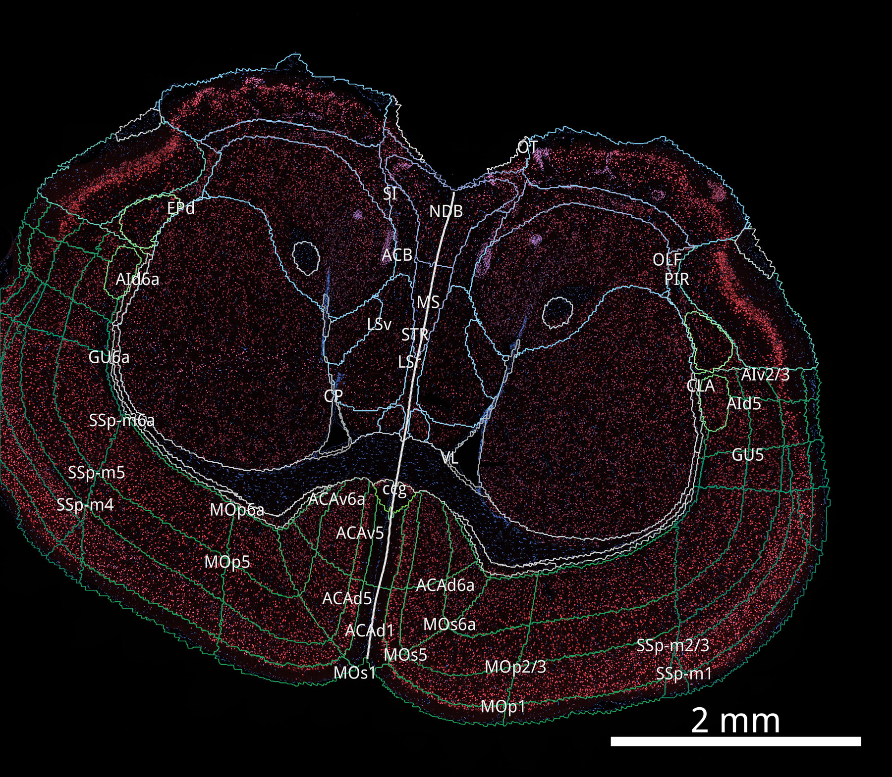

# 第 13 章 一键批量处理

参数调好以后，大批图片可以一次处理完，适合晚上或周末挂机运行。

1. **先用一两张图片把参数调好**（④ 识别参数、⑤ 共标参数），最好保存一个参数模板。
2. 在“① 项目与图片”点「一键批量处理整个文件夹…」。
3. 在对话框里点「选择文件夹…」，选择放图片的文件夹。对话框会显示“找到 N 张图片”。
4. 选项：
   - 配准到脑图谱（默认勾选）；
   - 配准后做非线性贴合（默认勾选）；
   - 已经处理过的图片也重新处理（默认不勾选。不勾选时，已经做完的图片会跳过）。
5. 点「开始」。

软件会依次对文件夹里所有 .qptiff / .tif 图片做：拆分脑片 → 识别细胞 → 共标 → 配准 → 质量检查 → 导出 Excel，全部使用当前项目里的参数。如果还没有打开项目，软件会在图片文件夹里自动新建一个“cFos分析项目”文件夹作为项目。

完成后：

- 项目文件夹里会生成“批量结果_日期时间.xlsx”；
- 弹出的窗口列出需要优先人工检查的脑片（质量“可疑”、出错、未配准的）。这些脑片在 Excel“按脑片汇总”表中已标红；
- 某张图片出错（文件损坏、通道数不同、找不到脑片等）时，软件会记录原因并继续处理其他图片，结束时一并列出。

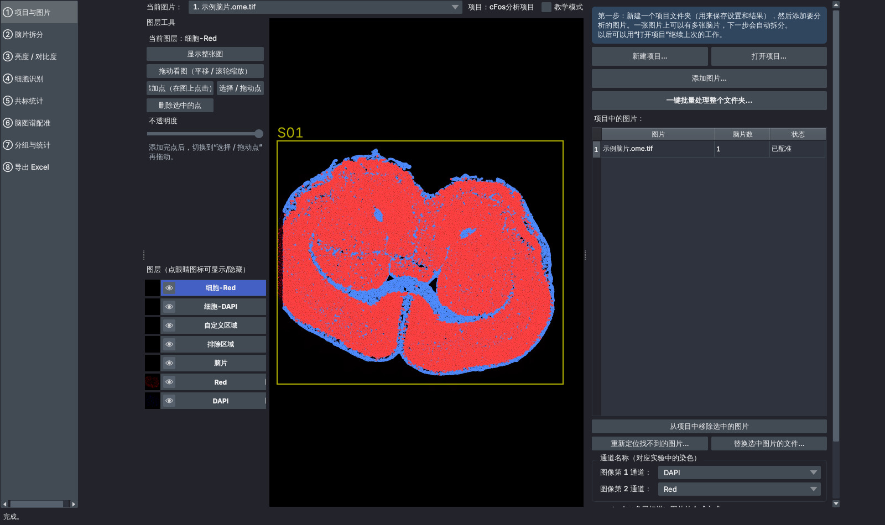

> 注意：批量处理完成**不等于**分析完成。请至少到“⑥ 脑图谱配准”中逐张检查配准，修正后再到“⑧ 导出 Excel”重新导出。

处理速度参考：示例脑片（一张脑片、2 个通道）在 4 核电脑上识别约 4 分钟，配准约 1 分钟。一张有 2 张脑片、4 个通道的 40 倍全片扫描图，在普通 8 核电脑上大约需要 10–30 分钟。核心越多越快。

# 第 14 章 项目文件夹里有什么

| 文件 / 文件夹 | 内容 | 能不能删 |
|---|---|---|
| cfos_project.json | 项目文件：所有设置、脑片方框、配准、分组等 | **不能删**。软件会自动备份一份，主文件损坏时自动用备份打开 |
| results 文件夹 | 识别结果、质量检查缓存、强度分布图、微调的模型等 | **不能删**，删了要重新识别 |
| 细胞统计结果.xlsx、批量结果_….xlsx | 导出的 Excel | 可以，随时能重新导出 |
| 质控图_…、细胞mask_… | 导出 Excel 时生成，文件夹名后半部分和 Excel 文件名相同 | 可以 |
| training 文件夹 | 模型微调用的标注块 | 不再微调模型时可以删 |
| 截图、截图/配准图 | ⑨ 截图制图的输出 | 可以 |
| 组间统计_…、功能网络_… | ⑦ 的输出 | 可以 |
| 运行日志.txt | 出错时排查用 | 可以，但出问题时请保留 |
| cfos_project.json.bak | 项目文件的自动备份 | 不要删 |

> 提示：原图不在项目文件夹里（除非你自己放进去）。把项目和原图放在同一个上级文件夹里，整体拷到另一台电脑时，软件能按相对位置自动找回原图。

# 第 15 章 推荐的工作规范

为了让结果可靠、可重复，建议实验室统一遵守：

1. **一个实验一套参数。** 对照组和实验组必须用完全相同的识别参数、共标参数、强度分级分界。调好后保存参数模板，所有图片都用它。
2. **调参数只用一部分图片，并且要盲法。** 不要看着实验组的结果去调参数。
3. **统计单位是动物，不是脑片。** 在“⑦ 分组与统计”里填写动物编号。
4. **每张脑片都要检查配准。** 自动配准再好，也要人工看一遍，特别是内部结构。
5. **报告准确率。** 用“检查识别准确率”在不同脑区各查几个框，把查准率、查全率、F1 写进论文方法部分（Excel“分析参数”表里有汇总）。
6. **保存“分析参数”表。** 论文方法部分需要的软件版本、模型、参数都在里面。
7. **看 q 值，不只看 p 值。**
8. **截图用统一的亮度和比例尺。**

论文方法部分可以这样写（请按实际参数修改）：

“荧光图像使用 cFos 脑片分析软件（v0.7）处理。各通道阳性细胞使用 StarDist 模型（2D_versatile_fluo）识别，阳性阈值为组织背景的 X 倍；与 DAPI 中心距离 ≤ 6 µm 的细胞计为有核细胞。人工点数检验显示 c-Fos 通道的查准率为 X%、查全率为 X%（n = X 个 250 × 250 µm 视野）。脑片使用 DeepSlice 定位并经 elastix 非线性配准到 Allen CCFv3 图谱，逐张人工检查和修正。按动物汇总后，组间比较采用 Welch t 检验，并用 Benjamini–Hochberg 方法校正多重比较（FDR）。”

# 第 16 章 常见问题

## 16.1 软件和安装

**问：双击图标后很久没反应？**
答：第一次启动需要 20–60 秒。请等一会儿，不要重复双击。超过 2 分钟还没出现窗口，用开始菜单里的“诊断启动（出问题时用）”启动，看黑色窗口里的出错信息（见第 17 章）。

**问：Windows 提示“Windows 已保护你的电脑”？**
答：点“更多信息”→“仍要运行”。软件没有购买数字签名，不是病毒。

**问：Mac 提示“无法验证开发者”？**
答：到“系统设置 → 隐私与安全性”，在页面下方点“仍要打开”。

**问：能在 Intel 芯片的 Mac 或者 Windows 7 上用吗？**
答：不能。Mac 版只支持 Apple M 系列芯片和 macOS 15 以上；Windows 版需要 Windows 10 / 11（64 位）。

**问：需要显卡吗？能用显卡加速吗？**
答：不需要显卡，全部在 CPU 上运行。目前没有开启显卡加速。

## 16.2 图片和通道

**问：我的图片加不进去？**
答：看弹出的提示：

- “通道数与项目中其他图片不同”：同一个项目只能放通道数一样的图片，另建一个项目；
- 无法打开：确认格式是 .qptiff / .tif / .ome.tif。`.vsi`、`.czi`、`.nd2` 等格式需要先用扫描仪或显微镜软件导出为 OME-TIFF 或 TIFF；
- 文件可能没有拷完整或已损坏，重新拷一次。

**问：我只有 2 个（或 3 个）通道，可以用吗？**
答：可以。软件按图片里实际有几个通道来工作，2–4 个通道都支持。

**问：通道颜色不对，或者 DAPI 被认成了别的通道？**
答：到“① 项目与图片”的“通道名称”框里手动改正。

## 16.3 项目和文件

**问：项目拷到另一台电脑后，提示“找不到原图”？**
答：打开项目时软件会提示有多少张图片找不到。点“是”，选择图片现在所在的文件夹（可以是整个硬盘），软件会按文件名在里面（包括子文件夹）搜索，找到后自动改好路径。也可以以后在“① 项目与图片”点「重新定位找不到的图片…」。已有的识别、配准结果都会保留。

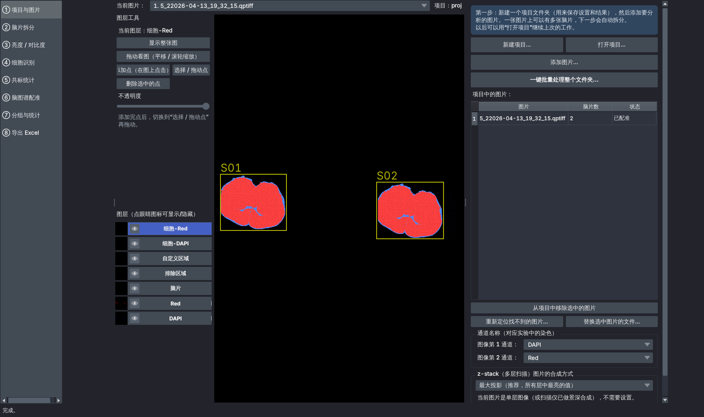

**问：原图改过文件名怎么办？**
答：选中这张图片，点「替换选中图片的文件…」，选择新文件。新文件必须是同一次扫描（通道数、尺寸一致）。注意：识别结果是按原文件名保存的，改名后需要重新识别。最好把文件名改回原来的名字。

**问：能多个人同时打开同一个项目吗？**
答：不要这样做，最后保存的人会覆盖别人的修改。一个项目同一时间只由一个人操作。

**问：导出 Excel 时提示文件被占用？**
答：Excel 文件正在被打开，先在 Excel 里关闭它，再导出。

## 16.4 识别和统计

**问：识别出的细胞明显太多 / 太少？**
答：先确认“③ 亮度 / 对比度”调得合适（太亮会误以为漏了很多）。然后按 7.2 节调参数：漏得多 → 调小“识别灵敏度阈值”；多圈了背景 → 调大阈值、调大最小面积、设置“自动阳性阈值”。厚切片记得用厚切片推荐参数。最后用“检查识别准确率”定量确认。

**问：DAPI 很多神经元没有识别出来？**
答：神经元的 DAPI 往往比胶质细胞暗。DAPI 默认已经用了“识别前提亮 0.5”和“灵敏度 0.3”，还不够时可以把灵敏度再调低到 0.2–0.25。同时在“⑤ 共标统计”里保持勾选“标记物细胞内 DAPI 信号够强，也算有核”。

**问：改了参数，结果没变？**
答：有些参数需要重新识别才生效（见 7.2 节表格最后一列）；只改阈值类参数时要点「按新阈值重新筛选」；共标参数要点「重新计算共标（所有图片）」；导出的 Excel 需要重新导出。

**问：为什么有的阳性细胞没有计入？**
答：默认“只统计有细胞核（DAPI+）的细胞”，没有细胞核的信号碎片不计入，但会在 Excel 中单独列出数量。另外，排除区域内的细胞不计入；未勾选“分析”的脑片不计入。

**问：脑区的细胞数和面积为什么是 0 或很小？**
答：脑区面积只计算组织轮廓以内的部分。切片没切到这个脑区、组织缺损、或画了排除区域时，面积会很小。组间统计中可以用“最小面积”过滤掉这类数据。

## 16.5 配准

**问：自动配准的位置差了很多？**
答：先在“切片方向”和“左右翻转”里确认方向；再调“前后位置”，然后调倾斜、缩放；最后用拖动修正局部。同一只动物的切片可以用“排序和联合校正”统一角度。

**问：拖动边界时图片在动，边界没动？**
答：需要先点「拖动边界修正」按钮进入拖动模式（按钮呈按下状态），并且在脑组织内的边界线上按下。

**问：配准做完了，Excel 里的脑区数据还是旧的？**
答：修改配准后要重新到“⑧ 导出 Excel”导出。

# 第 17 章 出错了怎么办

## 17.1 软件打不开

1. 在开始菜单找到“cFos 脑片分析”文件夹，点“诊断启动（出问题时用）”（Mac 版在应用包旁边的“诊断启动.command”）。
2. 会出现一个黑色窗口，软件启动时的所有出错信息都显示在里面。
3. 把这个窗口截图，发给负责维护软件的同学或老师。

## 17.2 运行中出错

- 软件出错时会弹出中文说明，并给出详细出错记录的位置（“运行日志.txt”）。日志在用户目录（Windows：`C:\Users\你的用户名\AppData\Local\cfos脑片分析\日志`；Mac：`~/Library/Logs/cfos脑片分析`），项目文件夹里也有一份；
- 批量处理时某张图片出错，会跳过它继续处理其他图片，结束时列出出错原因；
- 任务卡住不动时，可以点右下角的「取消」。已经完成的脑片都已保存，再点一次会从没做完的地方继续。

## 17.3 导出诊断包（推荐）

遇到任何问题，最省事的方法是导出诊断包：

1. 在“① 项目与图片”点「出问题时：导出诊断包（发给开发者）…」；
2. 简单写一句出了什么问题（例如“点自动配准后卡住不动”），也可以不写；
3. 软件生成“诊断包_日期时间.zip”并打开所在的文件夹。

诊断包里有电脑配置、软件版本、运行日志、项目设置和自检结果，**不含图片和细胞数据**，一般只有几十到几百 KB，可以直接用微信或邮件发送。收到诊断包的人一般不需要再问你“点了什么”“电脑什么配置”。

## 17.4 电脑变得很卡

软件最多使用一半的 CPU 核心，正常情况下不会让电脑卡死。如果仍然很卡：

- 关掉其他占内存的软件（浏览器开了很多标签页等）；
- 内存只有 8 GB 的电脑，处理大图时会比较慢，建议换一台内存大的电脑做批量处理；
- 状态栏会显示软件当前使用了几个 CPU 核心。

# 附录 A 操作速查表

| 我想… | 去哪里 | 点什么 |
|---|---|---|
| 开始一个新实验 | ① | 新建项目… → 添加图片… |
| 继续上次的工作 | ① | 打开项目… |
| 检查软件装好没有 | ① | 软件自检 |
| 让同学用一样的参数 | ① | 保存参数模板… / 导入参数模板… |
| 去掉折叠、气泡处的细胞 | ② | 画排除区域 → 保存区域 |
| 统计自己圈的区域 | ② | 画自定义区域 → 保存区域 |
| 找出有问题的脑片 | ② | 检查所有脑片的质量 |
| 看清细胞 | ③ | 自动，再微调最暗 / 最亮 |
| 试参数 | ④ | 预览当前视野的细胞识别 |
| 只改了阈值 | ④ | 按新阈值重新筛选 |
| 补加 / 删除细胞 | ④ | 手动校正细胞：补加 / 选择 / 删除选中 → 保存手动校正 |
| 知道软件数得准不准 | ④ | 放一个检查框 → 点细胞 → 计算准确率 |
| 区分强弱阳性 | ⑤ | 强度分级 |
| 局部边界不准 | ⑥ | 拖动边界修正 |
| 统一同一只动物的切片角度 | ⑥ | 同一动物的连续切片：排序和联合校正… |
| 组间比较 | ⑦ | 填写动物编号和组别 → 计算组间统计并画图 |
| 得到 Excel | ⑧ | 导出 Excel… |
| 论文放大图 | ⑨ | 画新的截图框 → 保存截图框 → 导出 |
| 论文配准图 | ⑥ 或 ⑨ | 导出配准图 |
| 一次处理很多图 | ① | 一键批量处理整个文件夹… |
| 出问题了 | ① | 导出诊断包 |

# 附录 B 默认参数一览

| 参数 | DAPI | 其他通道 |
|---|---|---|
| 识别灵敏度阈值 | 0.3 | 0.5 |
| 最小面积 | 10 µm² | 30 µm² |
| 最大面积 | 200 µm² | 600 µm² |
| 识别前提亮（伽马） | 0.5 | 1.0 |
| 最低平均强度 | 0（不限制） | 0（不限制） |
| 自动阳性阈值 | 不使用 | 不使用 |
| 局部对比度下限 | 不使用 | 不使用（厚切片预设 1.5） |
| 识别前减背景 | 不减（厚切片预设 25 µm） | 不减（厚切片预设 25 µm） |
| 去卷积 | 关闭（模糊程度 0.4 µm，迭代 10 次） | 关闭 |
| 共标中心距离上限 | 6 µm（厚切片 8 µm） | |
| 准确率检查配对距离 | 6 µm | |

# 附录 C 版本说明

本说明书对应 v0.7（2026 年 11 月）。v0.7 主要更新：细胞识别改用 ONNX Runtime（速度约快一倍，结果相同）；配准加入 DAPI 纹理，内部结构更准；新增识别准确率检查、平滑的脑区边界显示、整张脑片配准图导出、诊断包和软件自检；Excel“分析参数”表记录软件版本、识别引擎和每张脑片的配准方法。

源代码和安装包：<https://github.com/zjm199502/cfos-brain-slice>（源代码在 main 分支，安装包在 installers 分支）。
